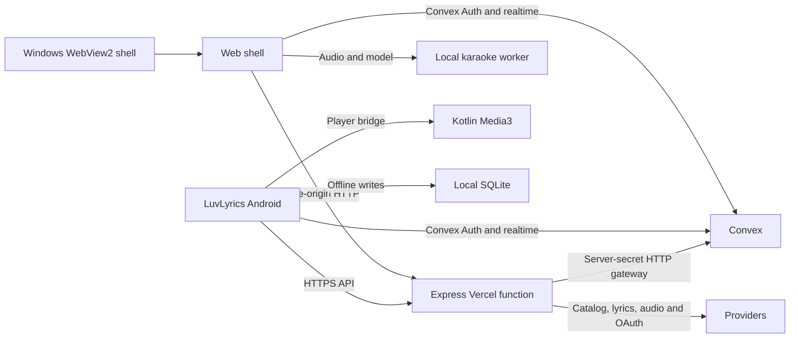

# Allegra codebase knowledge

| Baseline | Value |
| --- | --- |
| Audit date | 2026-11-11 (Asia/Calcutta) |
| HEAD | `9081dea8d35da50ea45b2b48e0ef236d4aaec917` |
| Branch | `fix/playback-skip-glitches` |
| Working tree | Dirty at capture. One tracked edit and eight pre-existing untracked paths. The scratch snapshot includes them. |
| Local `origin/main` comparison | 1 ahead, 0 behind. Local tracking ref `fe5df309`. |

Source citations refer to the captured checkout before the follow-up documentation refresh. Later Markdown edits can shift the live line numbers.

## Core brief

Allegra is a free music service with a website, LuvLyrics for Android, and an Allegra Windows shell. The Express API brokers catalog and audio, and Convex owns identity and durable listener data. Each device plays its own audio. Connect synchronizes playback intent and state, and web karaoke separates audio on the listener's device. `docs/architecture.md:8-36`, `docs/connect-contract.md:8-20`, `CLAUDE.md:111-116`, `CLAUDE.md:174-192`.

| Area | Stack and entry |
| --- | --- |
| Web | Next App Router, React, Tailwind, Motion. `apps/web/app/layout.tsx:29-46` mounts ClientShell. `apps/web/src/App.tsx:254-258` composes playback and Connect. |
| API | Express TypeScript. `api/index.ts:1-6` → `apps/api/src/app.ts:78-122`. |
| Convex | Convex Auth and listener state. `convex/http.ts:1-9`, `convex/schema.ts:1-12`. |
| Android | Expo, React Native, SQLite and Kotlin playback service. `apps/mobile/src/App.tsx:95-222`, `apps/mobile/CLAUDE.md:70-138`. |
| Windows | Rust, Wry/WebView2 and Win32. `apps/desktop/src/main.rs:494-528`, `apps/desktop/src/bridge.js:1-25`. |
| Shared packages | API DTOs and pure helpers in `packages/shared/types.ts:5-21`, `packages/shared/library.ts:143-160`; Connect state machine and ports in `packages/connect/src/index.ts:1-23`, `packages/connect/src/connectSession.ts:1034-1061`. |

### The rules

Statuses are scoped to cited paths. See §13 for contradictions. **DOC ONLY** means a project rule has no demonstrated global enforcement.

| # | Status | DO / NEVER / WHY / CHECK |
| --- | --- | --- |
| 1 | DOC ONLY | **Do** propose and update the HTTP contract with both consumers. **Never** silently rename or change units. **Why** a compatible build can still read the wrong value. **Check** add a mounted route test and cover web/mobile decoders. `CLAUDE.md:54-55`, `tests/infra/infra-files.test.mjs:155-163`. |
| 2 | VERIFIED IN CODE for main catalog path | **Do** proxy provider requests through Express. **Never** place provider credentials in public-prefixed variables. **Why** client bundles are readable. **Check** trace returned artwork/stream and search compiled bundles for names using fake values. Release Genius configuration is an exception under §13. `CLAUDE.md:56-57`, `packages/shared/types.ts:5-21`, `.github/workflows/mobile-apk.yml:90-98`. |
| 3 | VERIFIED IN CODE at the shared seam | **Do** return seconds in song, lyric and player DTOs. **Never** pass the Android native millisecond clock through unchanged. **Why** seek and lyric sync drift. **Check** fixture 12,345 ms → 12.345 s. `packages/shared/types.ts:5-27`, `apps/mobile/CLAUDE.md:105-115`. |
| 4 | VIOLATED AT `apps/api/src/oauth/router.ts:97-129` as a universal rule | **Do** use the Allegra envelope on normal JSON routes. **Never** wrap binary streams, OAuth, or MCP payloads in it. **Why** protocol clients read native shapes. **Check** HTTP status, headers and response body. `CLAUDE.md:59-60`, `packages/shared/types.ts:123-125`, `apps/api/src/mcp/server.ts:44-76`. |
| 5 | DOC ONLY globally | **Do** animate transform and opacity with shared duration/easing and an opacity path for reduced motion. **Never** drive continuous layout or drop a feature when motion is reduced. **Why** frame cost and accessible operation. **Check** at all four widths and on a real phone, with reduced motion on and off. `CLAUDE.md:61-64`, `DESIGN.md:165-190`, `docs/motion-design-system.md:202-230`. |
| 6 | DOC ONLY for ban on all `any` | **Do** keep strict TypeScript and narrow provider types. **Never** cast unvalidated external JSON directly to a DTO. **Why** types disappear at runtime. **Check** typecheck and malformed input fixtures. `CLAUDE.md:65-65`, `packages/connect/tsconfig.json:1-13`. |
| 7 | VIOLATED AT `apps/api/src/oauth/clients.ts:119-136` | **Do** set per-provider deadlines through body read and catch failures at the provider boundary. **Never** make the next cascade provider wait on a failed one. **Why** headers can arrive before a stuck body. **Check** stalled-body and malformed-response fixtures. `CLAUDE.md:66-67`, `apps/api/src/lib/fetchWithTimeout.ts:21-38`. |
| 8 | VERIFIED IN CODE for logger use, redaction gap at `apps/api/src/lib/logger.ts:3-8` | **Do** use logger levels and explicit safe fields. **Never** log raw authorization, gateway credentials, provider keys or callback query strings. **Why** runtime logs are a separate data surface. **Check** capture serialized requests using fictional values. `CLAUDE.md:68-68`, `apps/api/src/app.ts:105-111`. |
| 9 | VERIFIED IN CODE for layout and main transport, shortcuts violate Connect routing | **Do** keep the layout-owned audio node and use `requestPlayback` for local intent. **Never** mix direct store state, local DOM writes and remote commands in a UI handler. **Why** pause, transfer and route changes must preserve intent. **Check** one command per key/pointer event and same node across navigation. `apps/web/app/layout.tsx:29-46`, `apps/web/src/App.tsx:281-300`, `apps/web/src/hooks/useAudioPlayer.ts:497-509`. |
| 10 | VERIFIED IN CODE on sampled load/seek paths | **Do** read play intent imperatively when loading and resume a playing seek on readiness. **Never** add `isPlaying` to an effect that restarts the media source. **Why** pause retriggers the load and seek can strand playback. **Check** pause mid-load, seek paused/playing, rapid next. `CLAUDE.md:74-80`, `apps/mobile/CLAUDE.md:79-126`. |
| 11 | VERIFIED IN CODE at route and test boundary | **Do** forward `Range` and preserve upstream `206`, `Content-Range`, `Accept-Ranges`. **Never** normalize audio success to 200. **Why** play can work while seek fails. **Check** mounted Express tests and local browser seek. `CLAUDE.md:86-92`, `apps/api/src/routes/stream.ts:1-21`. |
| 12 | VERIFIED IN CODE for source config | **Do** keep API and OAuth rewrites in Vercel before Next's app catch-all. **Never** rely solely on the frontend rendering. **Why** all HTTP data calls can silently 404. **Check** inspect generated Vercel route output and run infra tests. `vercel.json:6-22`, `tests/infra/infra-files.test.mjs:33-41`. |
| 13 | VERIFIED IN CODE for device boundary | **Do** keep web karaoke in the worker/client with an audible fallback or capability state. **Never** create a cloud separation job. **Why** model/device limits must leave playback usable. **Check** fallback, switch and seek on a real browser. `CLAUDE.md:101-104`, `docs/architecture.md:67-84`. |
| 14 | VERIFIED IN CODE for CI structure, version bump DOC ONLY where there is no gate | **Do** mount routers, sync shared copies, deploy additive Convex changes before production web, bump mobile/desktop versions with relevant release inputs. **Never** hand-edit generated files. **Why** old apps keep calling the current backend and installed updaters require version advancement. **Check** §10–11 and `CLAUDE.md:111-134,173-183`. |
| 15 | DOC ONLY as a permanent guarantee | **Do** keep replay disabled. **Never** enable screen recording from crash or performance consent. **Why** replay has a separate privacy purpose. **Check** SDK integrations and release configuration. `CLAUDE.md:198-202`. |

### Task router

| Work | Load |
| --- | --- |
| API, new provider, public URLs | §2–5 and §7. `apps/api/src/app.ts:78-167`, `docs/api-contract.md:1-60`, `docs/provider-integration.md:21-89`. |
| Playback, lyrics, karaoke, Connect | §2, §4, §8–10. `CLAUDE.md:70-104`, `docs/connect-contract.md:8-72`, `apps/mobile/CLAUDE.md:70-138`. |
| Auth, account data, sync and sharing | §2, §4, §7. `convex/_generated/ai/guidelines.md:1-50`, `packages/shared/library.ts:143-160`. |
| UI or motion | §9–10. `DESIGN.md:165-203`, `apps/mobile/DESIGN.md:182-220`, `apps/mobile/src/ui/AGENTS.md:1-12`. |
| CI, installer or deploy | §10–13. `docs/workflows.md:87-186`, `scripts/vercel-build.mjs:21-29`. |

### Ten silent failures

1. App loads, API routes 404 → check rewrite and mounted router.
2. Audio plays, seek fails → inspect upstream and downstream 206.
3. Pause immediately resumes → inspect load-effect dependencies and in-flight play intent.
4. Navigation stops music → check the layout-owned node's identity.
5. Remote player ignores or doubles a keypress → check both document handlers and Connect routing.
6. Shared logic changed on one side → compare generated API copies.
7. Provider matching improved, results did not → bump matcher cache version.
8. New server API works, installed phone fails → retain old Convex/HTTP call shapes.
9. APK or EXE replaces release but is invisible to installed clients → bump the matching version.
10. Unit test passes, first real call fails → exercise the mounted HTTP route and actual UI.
Evidence for 1–4, 6–10 at `CLAUDE.md:70-134,170-183` and for 5 at `apps/web/src/App.tsx:761-779`, `apps/web/src/hooks/useAudioPlayer.ts:497-509`.

### Commands and pre-commit

Install root workspaces with `npm ci`; install mobile separately with `npm ci --prefix apps/mobile`. Run `npm run typecheck`, `npm run lint`, `npm test`; all must exit 0. Run `npm run mobile:check` after Convex tests finish. Shared source changes require `npm run sync:shared` and the parity test. Convex edits require the development push and regenerated bindings as a separate authorized operation. Main-triggered APK inputs require an `expo.version` bump; desktop input changes require a `Cargo.toml` version bump. Test normal web use at `http://localhost:5173`. Keep deploys, production Convex, GitHub release commands and the env-sync script owner-controlled. A production-mode Vercel build calls Convex deploy. `package.json:9-33`, `CLAUDE.md:111-134,157-183`, `docs/workflows.md:133-184`, `scripts/vercel-build.mjs:21-29`.

## Reference

### 1. System architecture

Load for service boundaries and data ownership.

The browser and phone own media playback. API and Next share the public Vercel deployment, but only the API uses provider/server credentials. Convex owns durable authenticated data. Guest fallback can use in-process data with no Convex. The Vercel function must tolerate cold starts and independent instances. Windows wraps the live web app and exposes narrow native integration. `api/index.ts:1-6`, `vercel.json:2-22`, `apps/web/next.config.ts:17-24`, `apps/api/src/app.ts:114-166`, `docs/architecture.md:29-48`, `apps/mobile/src/database/db.ts:212-221`, `apps/desktop/src/main.rs:494-528`.

### 2. Core user journeys

Load when changing a product flow or diagnosing a failed handoff.

#### Express feature journeys

- Vercel rewrites /api/* and three OAuth discovery routes to the Express export at api/index.ts:1–6 (vercel.json:6–22). Local entry apps/api/src/index.ts:3–10 starts the same createAppFromEnv factory. apps/api/src/createAppFromEnv.ts:8–12 calls loadConfig and provides a warm-instance cache. apps/api/src/app.ts:80–175 installs security headers, path-specific CORS, optional logging, body parsers, route buckets, no-store by default, routers and JSON errors. Default JSON cap is 32 KiB. DJ transcribe allows 1 MiB, sync 512 KiB and paste 128 KiB (apps/api/src/app.ts:117–122).
- apps/api/src/services.ts:132–191 wires catalog and streaming to Saavn and Gaana, optional MusicBrainz authority, Convex stores behind ConvexGateway, and memory fallbacks. The gateway uses ConvexHttpClient with a function allowlist, separate query/mutation methods, and server-secret argument injection (apps/api/src/db/convexGateway.ts:8–77,100–151). Individual Convex functions enforce the secret (convex/profiles.ts:73–78,92,187,204,220).
- Compare packages/shared/types.ts:5–61,123–156 and apps/api/src/types.ts:3–57,108–114. They are separate definitions. scripts/sync-shared.mjs:1–47 copies named shared implementation modules into apps/api/src/shared. It does not generate apps/api/src/types.ts. Keep track duration in seconds distinct from op timestamps in milliseconds. SongSnapshot preserves provider ref (apps/api/src/user/libraryOps.ts:15–44, apps/api/src/routes/user.ts:173–201).
- JSON normally uses success/data/error. Health returns ok/version, 204 is empty, stream preserves media and HTTP Range status, OAuth speaks OAuth, and MCP speaks JSON-RPC. Common errors include 400 validation, 401 missing caller, 403 signed-in-only for guests, 404 missing resource, 429 rate, 502 provider/persistence failure, 504 deadline, and generic logged 500. See apps/api/src/routes/common.ts:6–40, apps/api/src/routes/imports.ts:89–105, apps/api/src/app.ts:124–126,169–172,302–330, apps/api/src/oauth/router.ts:64–72,97–128,313–317, apps/api/src/mcp/server.ts:22–29,65–76, apps/api/src/lib/streamResolver.ts:53–69.

#### API flow ownership

- Guest session POST creates a random profile and returns a signed 30-day bearer (apps/api/src/routes/auth.ts:33–41, apps/api/src/auth/auth.ts:76–80, apps/api/src/auth/verifier.ts:36–37). Express tries guest verification first, then Convex JWKS and configured issuer/audience. The subject before the first vertical bar identifies the profile (apps/api/src/services.ts:165–187, apps/api/src/auth/verifier.ts:53–98). callerProfile reads the profile and best-effort touches stale activity. An account with no profile must still exist in the configured Convex identity directory before creation (apps/api/src/routes/auth.ts:130–140, apps/api/src/auth/auth.ts:103–148, apps/api/src/db/convex.ts:119–131). accountUser returns 401 for no session and 403 for guest. getUserId uses resolveCaller, whose guest path does not check the profile (apps/api/src/routes/imports.ts:89–105, apps/api/src/routes/auth.ts:123–128, apps/api/src/auth/auth.ts:86–93).
- Guest merge: web linkGuestSession sends old guest token in body with current bearer (apps/web/src/lib/api.ts:717–729). Route verifies source guest, AuthService merges profile, then likes/playlists go through LibraryStore (apps/api/src/routes/auth.ts:48–72, apps/api/src/auth/auth.ts:155–169, apps/api/src/user/libraryOps.ts:73–90). mergeTaste sums weights and signal counts, so replay cannot be assumed harmless for taste (apps/api/src/auth/auth.ts:255–265, apps/api/src/user/taste.ts:196–214).
- Search/play: web searchSongs reaches bounded q/limit/page (apps/web/src/lib/api.ts:211, apps/api/src/routes/catalog.ts:30–39). CatalogService searches Saavn first, tries Gaana after successful empty Saavn, collapses releases and optionally enriches top result. Suggest skips Gaana/enrichment and has public edge caching (apps/api/src/catalog/catalog.ts:99–161, apps/api/src/routes/catalog.ts:8–27). normalizeSong produces API stream URL, not provider CDN URL (apps/api/src/lib/normalize.ts:7–41). Stream rejects URL identities, passes Range unchanged, resolves Saavn or qualified Gaana, retries one 403/404 with fresh URL, preserves upstream 200/206/416 and Range headers, and aborts on disconnect once its listener is installed (apps/api/src/routes/common.ts:64–69, apps/api/src/routes/stream.ts:8–18, apps/api/src/lib/streamResolver.ts:46–147). Song hydration keeps request order, batches uncached Saavn IDs in groups of 20, falls back to individual requests and omits missing rows (apps/api/src/catalog/catalog.ts:54,247–293).
- Home explicit region wins over Vercel's India geo headers (apps/api/src/routes/catalog.ts:138–155). Suggestions, album, artist, faces and home methods start at apps/api/src/catalog/catalog.ts:300,354,373,392,444,481. Apple RSS charts go through TopChartService, with separately cacheable successful results (apps/api/src/routes/charts.ts:8–20, apps/api/src/services.ts:241–245, apps/api/src/services/topChart.ts:37–44).
- Lyrics starts with verified data, runs official Saavn fallback alongside providers, and allows lyric-site words after a grace period. Primary lookup tries LRCLIB variants then BetterLyrics, LyricsPlus, Unison, Lyrica and KuGou in parallel. Synced beats plain in the aggregator tier (apps/api/src/services/lyrics.ts:113–173,276–368). Tamil site builds URLs from same-site slugs, checks film/credits, and keeps provenance URL private in its representation. Fetcher follows redirects (apps/api/src/providers/lyricsSites/tamil2lyrics.ts:232–291, apps/api/src/providers/lyricsSites/lyricSites.ts:47–52,83–101). Public sources provide candidates for preview. Account-only submit/paste/report use exact shapes and reference checks. Submit rebuilds timing from source data (apps/api/src/routes/lyricSync.ts:9–36, apps/api/src/services/lyricSync.ts:84–158). Translation uses MyMemory and optional LibreTranslate without an LLM (apps/api/src/routes/discovery.ts:15–43, apps/api/src/services.ts:235–240). A primary lyrics miss is 404, alternatives returns empty array, verified returns null in success (apps/api/src/routes/lyrics.ts:19–68).
- Library: likes, playlist edits, guest merge and cross-device ops converge on LibraryStore. ListenerActions checks playlist ownership in the caller's own profile (apps/api/src/routes/user.ts:28–201, apps/api/src/user/actions.ts:471–475). Library ops capture server receivedAt before auth, align plausible sentAt, then return rev/rejected/superseded/applied. Change feed paginates by rev with full-resync continuation (apps/api/src/routes/user.ts:173–204, apps/api/src/user/actions.ts:238–287). For profile updates, passing a read profile as base avoids first duplicate read. ConvexUserStore reruns the change on a fresh version after a conflict, so keep the callback free of network and side effects (apps/api/src/auth/auth.ts:180–193, apps/api/src/db/convex.ts:49–67).
- Share/unshare requires an owned playlist. openShare verifies code, live owner/playlist and isPublic. Public response contains name, description, owner display name, artwork URL and songs. Saving creates a private copy without a source cover key. Public reports accept known reasons and bounded detail/contact (apps/api/src/routes/shared.ts:21–111, apps/api/src/user/actions.ts:179–224). Cover upload checks caller/playlist and declared MIME/length before generating a Convex URL. Client uploads directly, then PATCH attaches a storage ID inspected for WebP/JPEG and 300 KiB cap. See backlog for storage ownership (apps/api/src/routes/uploads.ts:16–53, apps/api/src/routes/user.ts:52–96, apps/api/src/lib/covers.ts:6–16, convex/covers.ts:13–42).
- Settings PATCH normalizes languages, merges primitives and clears recents/taste on personalization false. Memory-derived cleanup is best effort and Convex owns atomic cleanup (apps/api/src/routes/user.ts:235–275, apps/api/src/db/convex.ts:18–20, convex/profiles.ts:139). Recommendations are profile-backed no-store catalog ranking. Radio allows anonymous and hands the client candidates and optional taste (apps/api/src/routes/discovery.ts:46–69, apps/api/src/routes/radio.ts:19–41). Recent play accepts snapshots to retain provider/metadata, deduplicates same song/time, and uses per-event marking for listen signals when the corresponding history exists (apps/api/src/user/actions.ts:292–378).
- File import parses locally and sends at most 50 track metadata entries to /import/match. Apply chosen matches through library ops and reconcile responses. Taste seed accepts bounded counts only when personalization allows it (apps/api/src/routes/imports.ts:15–67,90–119, apps/api/src/services/importMatch.ts:94–143, apps/web/src/components/import/ImportPage.tsx:111–115,227, apps/mobile/src/store/fileImportStore.ts:189–204).
- Spotify: enabled with import. Connect takes web/mobile selector, saves expiring single-use state and starts PKCE. Callback consumes it and uses fixed web/mobile return destinations. Sync claims a lease, matches exact songs, writes through library ops and checkpoints after writes. Connection generation fences work from an old authorization. Convex daily scheduler calls secret-gated route and can continue on more=true (apps/api/src/app.ts:151–152, apps/api/src/routes/spotify.ts:14–79, apps/api/src/services/spotifyTransfer.ts:56–89,120–184,193–229, convex/spotifyCron.ts:27–60).
- Blend: account-only flag, current policy consent for create/accept, caller-scoped membership, optional idempotency key, configured link origin. Detail calls the read/build service, with Convex store behind secret (apps/api/src/routes/blends.ts:74–211, apps/api/src/services/blendBuild.ts:112–156, convex/blends.ts:165,225,255).
- DJ public BYOK routes validate bounded fields and dispatch fixed upstream providers. Turn limits six model requests and four catalog searches within a 45 s abort-signal window, then validates committed plan against candidates (apps/api/src/routes/dj.ts:11–19,62–96,109–146,228–307,338–342). Voice accepts bounded WAV, or text and provider options, and returns transcript or base64 MP3 (apps/api/src/routes/djVoice.ts:119–161). Keys are passed in request body, forwarded in upstream auth header and absent from the custom summary log (apps/api/src/routes/dj.ts:93–96,244–248, apps/api/src/routes/djVoice.ts:72–99,108–113).
- Consent/export/erase uses own profile. Export pages library with completion indicator and gets shares, devices, LuvLinks, top tally and blends. Delete calls store erase then returns 204 (apps/api/src/routes/account.ts:26–118, apps/api/src/auth/auth.ts:202–209, apps/api/src/db/convex.ts:86–113).
- MCP discovery advertises resource and authorization URLs. Auth flow supports registration or HTTPS metadata URL, exact registered redirect match, S256 PKCE, sealed consent, single-use code and rotated refresh. OAuth uses distinct derived key, checked token type and music scope. MCP validates issuer/audience, creates stateless server on POST, then tools fetch a fresh profile and reuse ListenerActions (apps/api/src/oauth/router.ts:96–129,132–191,194–257,261–330, apps/api/src/oauth/tokens.ts:15–67, apps/api/src/mcp/server.ts:41–76, apps/api/src/mcp/context.ts:17–20, apps/api/src/mcp/tools.ts:65–86). ConvexGrantLedger fails closed. MemoryGrantLedger is fallback without Convex (apps/api/src/db/convex.ts:237–249, apps/api/src/services.ts:245–246).

#### Web and browser integration

**Load this when changing the persistent web shell, any browser player action, or a web-facing API response.**

- App entry: `apps/web/app/layout.tsx:28–47` owns the shell and telemetry. `apps/web/app/ClientShell.tsx:3–15` dynamically imports `App` with SSR disabled and wraps it in the Convex sign-in provider. The Next optional catch-all serves a static empty page shell and delegates view selection to the client, `apps/web/app/[[...slug]]/page.tsx:3–15` and `apps/web/src/lib/routes.ts:32–132`. The persistent `<audio>` is rendered in `apps/web/src/App.tsx:2338`. Put views under this shell and keep the element mounted across navigation.
- HTTP seam: development rewrites same-origin API and OAuth discovery to local Express, `apps/web/next.config.ts:15–25`. `apps/web/src/lib/api.ts:74–117` resolves the API base, prefers the in-memory account token and falls back to the stored guest credential. `send` attaches cancellation and retries an eligible guest 401 once, `apps/web/src/lib/api.ts:140–181`. `request<T>` validates the envelope before surfacing API status, code and Retry-After, `apps/web/src/lib/api.ts:184–200`. Keep worker model downloads, Blob URLs and direct signed cover uploads in their specific helpers rather than teaching the JSON client to decode binary media.
- Auth journey: `AuthDialog.startGoogle` remembers consent and invokes the sign-in context, `apps/web/src/components/AuthDialog.tsx:89–118`. `ConvexSignInProvider` returns to pathname plus query and publishes the Convex token to API calls, `apps/web/app/ConvexSignInProvider.tsx:46–76`. `ensureSession` shares guest creation, `apps/web/src/lib/api.ts:689–705`. The first authenticated render calls `linkGuestSession`, which posts the old guest token in the body and removes it after an acknowledged response, `apps/web/src/lib/api.ts:717–737`. Express resolves the bearer and guest separately, then links through the auth service, `apps/api/src/routes/auth.ts:48–71`. Reload and sign-out failure behavior is FE-002.
- Search/typeahead: `CommandPalette` keeps typed text and results local, puts recent matching songs ahead of bounded catalog results, and has keyboard selection, `apps/web/src/components/CommandPalette.tsx:60–78`, `apps/web/src/components/CommandPalette.tsx:204–227`, `apps/web/src/components/CommandPalette.tsx:272–311`. App debounces full search for 250 ms and passes an AbortSignal, `apps/web/src/App.tsx:702–714`. The API client exposes distinct search, batch refs, chart, typeahead, radio, artist, album and Home requests, `apps/web/src/lib/api.ts:211–274`. Local selection uses radio context for search hits, then calls `audio.selectSong`, `apps/web/src/App.tsx:1217–1265`. A resolved catalog row goes through source selection, metadata and the playback funnel, `apps/web/src/hooks/useAudioPlayer.ts:93–160`, `apps/web/src/hooks/useAudioPlayer.ts:455–484`. Account recommendations are cancellable by current taste context, `apps/web/src/App.tsx:898–913`.
- Local playback: `requestPlayback` records user intent and controls the element, `apps/web/src/hooks/useAudioPlayer.ts:93–119`. Metadata and event handlers update the playhead/playing/buffering state, `apps/web/src/hooks/useAudioPlayer.ts:351–452`. The source effect depends on song and stable playback callback. Seek clamps seconds, captures whether the element was playing and resumes through the funnel, `apps/web/src/hooks/useAudioPlayer.ts:273–282`. Advance and repeat use the current queue refs, `apps/web/src/hooks/useAudioPlayer.ts:190–241`. Connect-aware App controls route through the shared session when a remote owner is shown, `apps/web/src/App.tsx:254–325`. The duplicate legacy keydown handler violates that routing (FE-001). Loading media, racing picks and karaoke source swaps have separate boundaries (FE-004, FE-005).

- Connect restore: `useConnect` creates a PlayerPort with callback-based snapshots, bounded queue stager and source/metadata waits before seeking, `apps/web/src/hooks/useConnect.ts:318–361`. It publishes local snapshots to listeners and binds a Convex transport for the leader tab, `apps/web/src/hooks/useConnect.ts:389–396`, `apps/web/src/hooks/useConnect.ts:447–483`. `packages/connect/src/convexWire.ts:239–264` assembles the watch only after devices, state, inbox and outcomes arrive. `packages/connect/src/connectSession.ts:400–425` restores a song from the first server snapshot at its sampled position, paused. `packages/connect/src/connectSession.ts:700–737` ignores player events during restore and requires a song to report. Browser device lifecycle and actual remote audio still need a two-tab/device check.
- Library sync: `usePlaylists.reload` gets legacy data on the first load and the revisioned feed, reduces latest change per key, hydrates missing Saavn metadata, then builds maps for visible rows and retains unresolved saved IDs, `apps/web/src/hooks/usePlaylists.ts:148–260`. `createLibrarySong` can display a metadata-only row. `exactSaavnMatch` only accepts exact title/lead artist with a Saavn candidate, `apps/web/src/lib/libraryRows.ts:33–57`. `App.toggleLike` writes a provider-qualified op, uses server rejection to trigger rollback, and exposes action errors, `apps/web/src/App.tsx:1631–1665`. Inspect server op semantics and the playlist-loading ticket FE-006 before adjusting cursor or fallback.
- Share, import and Blend: the shared playlist view fetches by code and passes songs to `CollectionPage`, `apps/web/src/App.tsx:671–683`, `apps/web/src/App.tsx:1986–2006`. The client supports share/revoke, fetch, save and report, `apps/web/src/lib/api.ts:775–797`. Cover upload signs, sends the file by XHR and applies its key, `apps/web/src/lib/api.ts:490–545`. `ImportPage` parses via a worker, matches and writes library ops with a retained operation time, `apps/web/src/components/import/ImportPage.tsx:105–111`, `apps/web/src/components/import/ImportPage.tsx:141–238`. `SpotifySyncPanel` starts official OAuth and refreshes state/list, `apps/web/src/components/import/SpotifySyncPanel.tsx:75–150`. `BlendPage` fetches a private detail and its invite and exposes leave/rename, `apps/web/src/components/blend/BlendPage.tsx:45–86`, `apps/web/src/components/blend/BlendPage.tsx:163–179`, `apps/web/src/components/blend/BlendPage.tsx:291`.
- Lyrics and Karaoke: App starts cancellable lyrics fetches and timed upgrades, `apps/web/src/App.tsx:788–846`, with client fetch/cascade alternatives and translation wrappers, `apps/web/src/lib/api.ts:298–315`, `apps/web/src/lib/api.ts:549–560`. `LyricsSyncDialog` adds a text paste, runs an alignment attempt and saves the listener choice, `apps/web/src/components/LyricsSyncDialog.tsx:94–125`. `useLiveKaraoke` reads the same audio element, uses a local bridge or rendered instrumental, and cancels obsolete prefetches, `apps/web/src/App.tsx:337–341`, `apps/web/src/hooks/useLiveKaraoke.ts:199–282`, `apps/web/src/hooks/useLiveKaraoke.ts:573–616`. Keep separation on the listener's device.
- DJ and LuvLink: App gives the DJ concrete playback and queue actions, `apps/web/src/App.tsx:1295–1392`, `apps/web/src/App.tsx:1464–1606`. The DJ client exposes turn, transcription and speech requests, `apps/web/src/lib/api.ts:568–603`. Browser recording uses the secure-context mic and local/cloud transcribers, `apps/web/src/hooks/useDjVoice.ts:186–202`, `apps/web/src/hooks/useDjVoice.ts:452–501`. LuvLink room controls call the room session from `apps/web/src/components/luvLink/LuvLinkPage.tsx:39–86`. App resolves the room song, waits for source and metadata, samples room position after the wait, then calls seek and playback, `apps/web/src/App.tsx:1860–1883`.
- Preferences, consent and telemetry: settings read/write local storage for device settings, `apps/web/src/lib/settings.ts:186`. Account personalization reads server settings, `apps/web/src/components/SettingsPage.tsx:186–198`, and API wrappers expose consent, export and delete, `apps/web/src/lib/api.ts:799–819`. `Telemetry` mounts Analytics and Speed Insights after the saved setting permits it. Session replay remains disabled, `apps/web/app/Telemetry.tsx:9–25`.
- UI system: `apps/web/src/styles/tokens.css:8–43` defines surfaces and stable action colors, and `apps/web/src/styles/tokens.css:141–150` defines layout and DM Sans/DM Mono typography. `apps/web/src/motion/index.ts:3–80` defines shared durations, springs and reduced transitions. `apps/web/src/styles/app.css:108–110` provides focus-visible outline, and `apps/web/src/App.tsx:1896` provides a skip link. For overlays, use a document-body portal, keep focus contained and restore it, with `apps/web/src/components/LyricsSyncDialog.tsx:65–70`, `apps/web/src/components/LyricsSyncDialog.tsx:128–136` as a code example. AuthDialog is a counterexample (A11Y-001). Motion rules are partially violated by raw `duration: 0.45` in `apps/web/src/components/ArtistPreviewCard.tsx:48` and `box-shadow` transitions in `apps/web/src/styles/tokens.css:136–139`. No visual or contrast measurement done in this workstream.
- Performance and testing: `PlayheadStore` and `usePlayhead` provide an isolated subscription, `apps/web/src/lib/playhead.ts:13–38`. Keep per-frame progress out of shell React state. Test budgets separately from source observations. Web default unit tests run only `src/lib/*.test.ts`, `apps/web/package.json:15`. Browser tests cover navigation continuity, pause, seek, lyrics, DJ settings and Karaoke, `tests/e2e/app.spec.ts:102–158`, `tests/e2e/player.spec.ts:52–149`, `tests/e2e/karaoke.spec.ts:3`. The Playwright projects use 1280x860 and 375x812, `tests/e2e/playwright.config.ts:36–45`. Root-workspace unit pass alone provides no browser evidence. `tests/performance/search-to-play.web.spec.ts:240` measures actual element progress along with visible result timing. Any claimed 360, 768, 1280 or 1920 layout needs live browser evidence.

#### LuvLyrics mobile JavaScript

Load this when changing the Android app's navigation, search/play flow, library, or import UI. The native playback, update, and release paths have separate coverage.

| Journey | Source-backed route and owner |
| --- | --- |
| Start and recover | Expo registers the root, Android widgets and island JS wake callback in `apps/mobile/index.ts:18-34`. Root re-exports `src/App` (`apps/mobile/App.tsx:1-6`). Boot preloads data, opens the write DB and loads songs/playlists, then schedules idle work and exposes retry on failure (`apps/mobile/src/App.tsx:98-224`). Root providers wrap navigation in account, player, and Connect order (`apps/mobile/src/App.tsx:265-278`). |
| Open a screen or external link | `RootNavigator` mounts `useDeepLinks`, the stack, and Now Playing, LuvLink and Scan Code routes (`apps/mobile/src/navigation/RootNavigator.tsx:47-109`). The tab navigator owns Stream, Luvs, Library and Search plus secondary screens. Library nests Blend, Import and SharedPlaylist (`apps/mobile/src/navigation/TabNavigator.tsx:79-87,175-201`). The deep-link parser normalizes share/Blend/LuvLink HTTPS targets and decodes `lyricflow://`; handler selects a tab, queues an invite or opens the share target (`apps/mobile/src/hooks/useDeepLinks.ts:43-70,91-145`). Keep incoming route names in the navigator and the parser aligned. |
| Account sign-in and session | `AccountProvider` keeps one ConvexReactClient and supplies the secure-storage adapter to ConvexAuthProvider. Its bridge attaches library sync when the current token has a profile user ID (`apps/mobile/src/services/account/AccountProvider.tsx:25-26,53-84`, `apps/mobile/src/services/account/secureStorage.ts:18`). Google sign-in requests consent, saves pending policy version, and delegates browser return handling to `runGoogleSignIn`. Profile fetch records pending consent after authentication (`apps/mobile/src/services/account/AccountProvider.tsx:88-135`, `apps/mobile/src/services/account/signInFlow.ts:36`). |
| Search, stream and radio | Stream rows either play the displayed queue or start the song and its radio. Catalog failure offers access to saved songs (`apps/mobile/src/screens/StreamScreen.tsx:538-553,620-639`). `searchOfficial` queries YouTube Music metadata and the catalog in parallel and resolves streamable matches with deduplication (`apps/mobile/src/services/stream/officialSearch.ts:28-54`). `StreamService` normalizes catalog stream URLs and stages deduplicated playable items (`apps/mobile/src/services/stream/StreamService.ts:43-60,101-119`). Radio refill checks current queue before and after recommendation work (`apps/mobile/src/services/stream/StreamService.ts:392-419,437-484`). Android loads through `PlayerContext` → `nativeQueue` / `NativeAudioPlayer`; native reports advance and queue changes back to Zustand (`apps/mobile/src/contexts/PlayerContext.tsx:65-104,169-181`, `apps/mobile/src/services/NativeAudioPlayer.ts:125-131,156-160,319`). |
| Download | Stream song actions add the item to the download queue (`apps/mobile/src/components/stream/useStreamSongActions.tsx:23-37`). `DownloadManager` delegates Android work to the native Downloader module. The receipt read/clear methods let JS reconcile completed work (`apps/mobile/src/services/DownloadManager.ts:2-6,18-42`). Playback should still work from the saved copy when the catalog is unavailable (`apps/mobile/src/screens/StreamScreen.tsx:551`). |
| Read lyrics | `StreamService.loadLyrics` snapshots the current song, starts an abortable lookup, parses LRC, and checks the current store before applying (`apps/mobile/src/services/stream/StreamService.ts:351-383`). `LyricsRepository.searchSmart` combines the Echo cascade with Lyrica and scores results for editor search (`apps/mobile/src/services/LyricsRepository.ts:28-85`). `EchoLyricsCascade.fetchBest` caches results/misses, shares requests, prioritizes synced results and retains a plain fallback. `fetchAll` returns candidate results for selection (`apps/mobile/src/services/lyrics/EchoLyricsCascade.ts:19-43,68-106,119-151`). `useLyricsUpgrade` observes the current song for a plain-to-synced upgrade (`apps/mobile/src/hooks/useLyricsUpgrade.ts:10-16`). |
| Scan or share | Camera permission and photo decoding sit in `ScanCodeScreen`; camera and file picker use the same decoder and route through `openShareTarget` (`apps/mobile/src/screens/ScanCodeScreen.tsx:24-78`, `apps/mobile/src/services/share/openShare.ts:16`). App Links also use that share entry (`apps/mobile/src/hooks/useDeepLinks.ts:55-60,96-103`). `SharedPlaylistScreen` fetches the public playlist, offers save, and keeps streaming songs distinct from local download state (`apps/mobile/src/screens/SharedPlaylistScreen.tsx:17,39-62`). |
| Import Spotify | `ImportScreen` gates on an account and renders the Spotify connection panel and file import recovery (`apps/mobile/src/screens/ImportScreen.tsx:29-44,59-80`). The panel fetches status/playlists and opens an external OAuth session returning to `lyricflow://open/import` (`apps/mobile/src/components/import/SpotifySyncPanel.tsx:134-159,175-192`). File import reads bytes locally (`apps/mobile/src/services/import/importFile.ts:22,55-60`); the separate store records matching progress, review choices and resumable save chunks, so navigating away from the screen does not cancel work (`apps/mobile/src/store/fileImportStore.ts:63-71,132-162,165-221`). |
| Sync edits offline | `attach` reads session binding and sets up the Convex `library:myRev` watch. `choose` handles initial sync choice, then flush and pull reconcile the SQLite data (`apps/mobile/src/services/sync/LibrarySync.ts:45,74-126,217-245,253-283,301-342,398-447`). Shared operation batches pass through `postLibraryOps` with a send timestamp (`apps/mobile/src/services/sync/opsApi.ts:51`, `apps/mobile/src/services/sync/LibrarySync.ts:317-342`). The full resync path preserves queued local edits (`apps/mobile/src/services/sync/LibrarySync.ts:450-488,496-569`). Account-switch and superseded-edit issues are in the backlog. |
| Route to a Connect device | `ConnectProvider` constructs the shared session, injects the mobile player port and chooses a device route (`apps/mobile/src/services/connect/ConnectProvider.tsx:133,187-202,246`). `convexTransport` bridges generated runtime names to mutations/watched queries (`apps/mobile/src/services/connect/convexTransport.ts:17-29`). `pickRouter` delegates the ownership decision to shared `decidePlaybackRoute` (`apps/mobile/src/services/connect/pickRouter.ts:159-166`). Do not use a separate queue path for mobile UI controls that bypasses the Connect router. |

**UI patterns.** Import the primitives from `apps/mobile/src/ui/index.ts:12-48` and use the semantic theme roles. The button implementation separates visual and touch sizes, supports accessibility labels and uses shared tactile feedback (`apps/mobile/src/ui/Button.tsx:42-76,87-129`). Sheet uses a native modal, safe insets, keyboard animation and shared gesture rules (`apps/mobile/src/ui/Sheet.tsx:16-25`). Keep the 48 dp minimum and use the shared motion and haptic tokens (`apps/mobile/src/ui/AGENTS.md:3-7`, `apps/mobile/DESIGN.md:393-452`).

**Behavioral test anchors.** `apps/mobile/package.json:9-14` defines the Jest gate. Navigation/tab order `apps/mobile/src/navigation/shellNavigation.test.ts:13-20`; deep links `apps/mobile/src/hooks/useDeepLinks.test.ts:10-48`; browser sign-in cancellation/refusal `apps/mobile/src/services/account/signInFlow.test.ts:27-46`; remote pick, unknown track and stale result `apps/mobile/src/services/connect/pickRouter.test.ts:120-252`; full resync and cursor safety `apps/mobile/src/services/sync/LibrarySync.test.ts:114-134`; download cover fallback `apps/mobile/src/services/DownloadManager.test.ts:7-37`; import limits and local bytes `apps/mobile/src/services/import/importFile.test.ts:15-36`; lyrics priority, failures and shared abort `apps/mobile/src/services/lyrics/EchoLyricsCascade.test.ts:131-222`; shared UI contrast and control size `apps/mobile/src/ui/frontendSystem.test.ts:18-46`. These are test declarations and source traces. This mapping did not run the gate, verify a device, sign in, connect to Spotify, or measure rendering and playback latency.

#### Android native ownership

**Entry points and ownership.** The Android Activity applies native display density and launch rescue before loading React, and changes density without replacing the service (apps/mobile/android/app/src/main/java/com/lyricflow/app/MainActivity.kt:22-67, apps/mobile/android/app/src/main/java/com/lyricflow/app/recovery/LaunchGuard.kt:28-58, apps/mobile/android/app/src/main/java/com/lyricflow/app/startup/DisplayScale.kt:26-53). MainApplication constructs the React host and starts Expo lifecycle dispatch (apps/mobile/android/app/src/main/java/com/lyricflow/app/MainApplication.kt:22-61). The manually maintained Expo module list registers app-owned Kotlin views and modules (apps/mobile/android/app/src/main/java/expo/modules/ExpoModulesPackageList.kt:38-98). Gradle removes the generated Expo list that would collide (apps/mobile/android/build.gradle:26-41). Adding a module needs the Kotlin module, registration and the matching typed JS wrapper. The app also resolves autolinking through Expo settings (apps/mobile/android/settings.gradle:10-39).

**Main player trace.** UI calls usePlayerStore.requestPlayback, Android chooses NativeAudioPlayer through PlayerContext, and MainPlayerModule posts commands to the main looper (apps/mobile/src/store/playerStore.ts:442-461, apps/mobile/src/contexts/PlayerContext.tsx:49-75, apps/mobile/android/app/src/main/java/com/lyricflow/app/modules/MainPlayerModule.kt:391-413). Native seek uses seconds from JS converted to millisecond ExoPlayer calls. PlaybackService creates the single persistent Media3 ExoPlayer and QueueEngine, uses focus/noisy handling, and gives MediaSession a QueueForwardingPlayer for notification, lock screen and remote skips (apps/mobile/android/app/src/main/java/com/lyricflow/app/services/PlaybackService.kt:233-311, apps/mobile/android/app/src/main/java/com/lyricflow/app/services/QueueForwardingPlayer.kt:12-34). Do not attach expo-audio to this Android path. Luvs preview deliberately has a separate short-lived, bounded player pool that requests transient focus and releases when Luvs closes (apps/mobile/android/app/src/main/java/com/lyricflow/app/modules/LuvsPlayerModule.kt:54-101, apps/mobile/android/app/src/main/java/com/lyricflow/app/modules/LuvsPlayerModule.kt:121-195). This is separate from the app's persistent queue. Platform focus applies to the Media3 service. PlayerBridge includes suppression in status, and the React mirror separates audible play state from transport intent (apps/mobile/android/app/src/main/java/com/lyricflow/app/modules/PlayerBridge.kt:48-75, apps/mobile/android/app/src/main/java/com/lyricflow/app/modules/PlayerBridge.kt:113-135, apps/mobile/src/contexts/PlayerContext.tsx:134-174). Real interruption and reacquisition require device checks.

**Queue and position.** The Kotlin queue owns edits, shuffle, repeat, skip, end handling and emits track transitions, coalesced queue changes and low-queue refill requests (apps/mobile/android/app/src/main/java/com/lyricflow/app/playback/QueueEngine.kt:32-58, apps/mobile/android/app/src/main/java/com/lyricflow/app/playback/QueueEngine.kt:135-235, apps/mobile/android/app/src/main/java/com/lyricflow/app/playback/QueueEngine.kt:266-394). An opaque expectTag rejects stale app-initiated edits. Android next/previous are playback actions and normally resume. Previous above 3 seconds restarts the current item. Current song survives replaceQueue, which changes only its neighbors. The on-disk snapshot uses a sibling temp file and rename and restores paused (apps/mobile/android/app/src/main/java/com/lyricflow/app/playback/QueueEngine.kt:399-467, apps/mobile/android/app/src/main/java/com/lyricflow/app/playback/QueueSnapshot.kt:13-67). Clear ordering has a defect in AND-004. The JS selected queue window caps at 1,500 items in apps/mobile/src/playback/nativeQueue.ts:22-23,47-55. Native restore parser accepts up to 2,000 at apps/mobile/android/app/src/main/java/com/lyricflow/app/playback/QueueSnapshot.kt:36-50. Android status always emits on relevant player changes. Position tick cadence is 250 ms while UI watches active playback, as well as explicit seek/visibility changes (apps/mobile/android/app/src/main/java/com/lyricflow/app/modules/PlayerBridge.kt:41-75, apps/mobile/android/app/src/main/java/com/lyricflow/app/modules/PlayerBridge.kt:159-193).

**Recovery and edge cases.** Media3 handles focus and noisy output. Backgrounding keeps the foreground media service while playing. Swiping the app from Recents saves, pauses and stops the service (apps/mobile/android/app/src/main/java/com/lyricflow/app/services/PlaybackService.kt:237-250,313-340). The service uses a network wake lock for streaming and a local wake lock for files (apps/mobile/android/app/src/main/java/com/lyricflow/app/services/PlaybackService.kt:170-177,228-230). A stalled stream watchdog tries two seeks before failure. Transport recovery retries at 1, 2, 4 and 8 seconds. Refused links emit expired, and JS can refresh signed streams (apps/mobile/android/app/src/main/java/com/lyricflow/app/services/PlaybackService.kt:29-34,65-139, apps/mobile/src/playback/recovery.ts:33-52,130-147). A default-network callback can re-arm retries incorrectly (AND-003). Old/corrupt queue version and invalid entries are rejected on decode. Explicit clearing can leave stale restore data (AND-004). Device runtime for focus, retry, stale seek and real-device playhead was unverified.

**Android local workers.** DownloaderModule exposes work enqueue, progress/status and receipt APIs to JS. DownloadWorker stages audio, optional cover, and SAF copy and writes DownloadReceipt for reconciliation after JS was killed. ProgressBus emits best-effort in-process events (apps/mobile/android/app/src/main/java/com/lyricflow/app/modules/DownloaderModule.kt:15-82, apps/mobile/android/app/src/main/java/com/lyricflow/app/workers/DownloadWorker.kt:29-110, apps/mobile/android/app/src/main/java/com/lyricflow/app/workers/DownloadReceipt.kt:32-80, apps/mobile/android/app/src/main/java/com/lyricflow/app/workers/ProgressBus.kt:15-23). Keep APK installs separate from audio downloads.

**Android update and signing, seed 8.** About's UpdatePanel uses appUpdate.ts and appUpdateDownload.ts for GitHub release lookup and the native bridge (apps/mobile/src/components/about/UpdatePanel.tsx:82-160, apps/mobile/src/services/appUpdate.ts:11-16,58-74,130-145,182-199, apps/mobile/src/services/appUpdateDownload.ts:4-23). WorkManager runs unique app-update work with a connected-network constraint. Native worker writes to a private partial file, checks response completion, package and signer, and renames only when valid (apps/mobile/android/app/src/main/java/com/lyricflow/app/modules/AppUpdaterModule.kt:18-47, apps/mobile/android/app/src/main/java/com/lyricflow/app/workers/AppUpdateWorker.kt:16-62). The non-exported FileProvider exposes the updates subtree only through the scoped intent URI. Android asks for unknown-app install permission and user confirmation (apps/mobile/android/app/src/main/AndroidManifest.xml:31-34, apps/mobile/android/app/src/main/res/xml/update_file_paths.xml:1-4, apps/mobile/android/app/src/main/java/com/lyricflow/app/modules/AppUpdaterModule.kt:49-65). Gradle takes versionName from apps/mobile/app.json, hard-codes versionCode 1 and uses debug signing config for release. Workflow provisions the signing file from the named CI secret or the public Expo template, builds arm64 and publishes on main after checks + emulator launch. The signer of the published APK is UNVERIFIED (apps/mobile/android/app/build.gradle:90-115, .github/workflows/mobile-apk.yml:68-109,228-248). docs/workflows.md:93-94 is accurate about the path/configuration but omits the CI origin/fallback. Mobile AGENTS' older claim that PlayerContext always uses expo-audio/handles auto-next is VIOLATED on Android (apps/mobile/AGENTS.md:18-38, apps/mobile/src/contexts/PlayerContext.tsx:49-75, apps/mobile/android/app/src/main/java/com/lyricflow/app/playback/QueueEngine.kt:323-351). apps/mobile/CLAUDE.md:16-23 accurately describes WorkManager/signer checks and fixed versionCode. The promise that older builds are never offered is VIOLATED at apps/mobile/src/components/about/UpdatePanel.tsx:163-188 (AND-002).

**Intent and permission boundaries.** MainActivity is exported for the launcher, lyricflow/exp+lyricflow scheme and verified HTTPS links at /song/, /shared/, /blend/join/ and /luvlink/join/ on allegravibe.vercel.app. The browser fallback and Android package cert association are at apps/mobile/android/app/src/main/AndroidManifest.xml:38-63 and apps/web/public/.well-known/assetlinks.json:1-10. Expo Updates is disabled in manifest, and the rescue activity and widget receivers are non-exported (apps/mobile/android/app/src/main/AndroidManifest.xml:35-37,67,104-118). MediaSessionService is exported and uses default controller policy (AND-005). Island service and optional OutsideListener use Android binding permissions and require user enablement. Accessibility config says no window content, and IslandService ignores accessibility events. OutsideListener ignores notification posted/removed callbacks and OutsideMedia reads opted-in media session metadata to offer transfer (apps/mobile/android/app/src/main/AndroidManifest.xml:79-102, apps/mobile/android/app/src/main/res/xml/island_accessibility.xml:2-11, apps/mobile/android/app/src/main/java/com/lyricflow/app/island/IslandService.kt:151-153, apps/mobile/android/app/src/main/java/com/lyricflow/app/island/OutsideMedia.kt:26-32,107-139,199-220,276-304). Neither the effective merged release manifest nor installed permissions were checked. The two debug manifests opt into cleartext. The sampled main manifest does not opt into cleartext. MainPlayerModule limits incoming media URI schemes to file/content/https, though the media data source follows cross-protocol redirects and release policy is unverified (apps/mobile/android/app/src/debug/AndroidManifest.xml:6, apps/mobile/android/app/src/debugOptimized/AndroidManifest.xml:6, apps/mobile/android/app/src/main/AndroidManifest.xml:31, apps/mobile/android/app/src/main/java/com/lyricflow/app/modules/MainPlayerModule.kt:523-530, apps/mobile/android/app/src/main/java/com/lyricflow/app/services/PlaybackService.kt:259-267).

**Native view pattern and budgets.** The Expo view module maps props/events, coalesces in OnViewDidUpdateProps and calls the native renderer's commit. Keep playback/navigation decisions in JS unless the component is an existing native owner. The native queue clips to its frame and draws only the visible rows, with full payload/text preprocessing cost covered by AND-006. Native lyrics build layouts off the main thread and guard generations, mark the accessibility tree active only while live, and cancel frame work on detach (apps/mobile/android/app/src/main/java/com/lyricflow/app/modules/NativeQueueListModule.kt:10-23, apps/mobile/android/app/src/main/java/com/lyricflow/app/views/NativeQueueListView.kt:148-161,485-499,588-650, apps/mobile/android/app/src/main/java/com/lyricflow/app/views/NativeLyricsView.kt:174-245,296-325). Native tab semantics expose buttons/tabs and selected state, and render separate keyboard-focus style. Its 130-percent label cap is AND-007 (apps/mobile/android/app/src/main/java/com/lyricflow/app/views/NativeTabBarView.kt:75-124,362-390). Platform SP conversion in the queue renderer accounts for nonlinear Android font scaling (apps/mobile/android/app/src/main/java/com/lyricflow/app/views/NativeQueueListView.kt:184-189). Island budgets pick LOW/MID/HIGH by RAM, cores, version, power saver and refresh rate (apps/mobile/android/app/src/main/java/com/lyricflow/app/island/IslandBudget.kt:13-42). NativeFlowGlow stops when inactive/detached and consults platform animation enablement (apps/mobile/android/app/src/main/java/com/lyricflow/app/views/NativeFlowGlowView.kt:150-194). Actual 200 percent text, TalkBack traversal, contrast and frames were unverified.

**Native verification.** .github/workflows/mobile-ci.yml:74-111 uses Java 17 and the Kotlin JVM gate; examples are ResumeOnlineTest, QueueMathTest, QueueSnapshotTest, and TabBarGeometryTest. .github/workflows/mobile-apk.yml:156-224 builds x86_64 release-type for launch check, separately from the arm64 publication artifact. .github/scripts/mobile-launch-check.sh:87-116 checks About accessibility and its Updates panel; it does not install the release over an earlier app. .github/scripts/mobile-player-probe.sh:24-146 covers launch and real transport control taps, with no audible-sample proof. App signer, emulator and physical-phone checks remain unverified in the audit. No Gradle build or native tests were run for this area.

**Native dependency status.** Gradle wrapper pins 8.14.3 (apps/mobile/android/gradle/wrapper/gradle-wrapper.properties:3); version range compatible with this project and latest stable were not verified. Media3 1.11.1 (apps/mobile/android/app/build.gradle:188-191) matches the latest stable shown upstream. WorkManager 2.9.0 (apps/mobile/android/app/build.gradle:194) is behind upstream stable 2.12.0. The latter raises minSdk to 24. Confirm the effective Expo minSdk and worker/backoff behavior before changing it. No Gradle transitive version/advisory inventory was verified. [Media3 releases](https://developer.android.com/jetpack/androidx/releases/media3), [WorkManager releases](https://developer.android.com/jetpack/androidx/releases/work), [Gradle 8.14.3 release notes](https://docs.gradle.org/8.14.3/release-notes.html), accessed 2026-11-11.

**Rejected candidates.**

- APK goes straight to the installer unvalidated. Rejected. AppUpdateWorker checks downloaded APK package and signer before renaming, and the installer requires OS permission and confirmation (apps/mobile/android/app/src/main/java/com/lyricflow/app/workers/AppUpdateWorker.kt:47-59, apps/mobile/android/app/src/main/java/com/lyricflow/app/modules/AppUpdaterModule.kt:49-65). Separate signer/candidate risks are AND-001/002.
- Android island accessibility overlay reads screen content and OutsideListener processes notification text. Rejected for these paths. XML disables retrieval, the accessibility event method is a no-op, and notification callbacks do nothing. Optional active-media session metadata access is a separate explicit capability (apps/mobile/android/app/src/main/res/xml/island_accessibility.xml:2-11, apps/mobile/android/app/src/main/java/com/lyricflow/app/island/IslandService.kt:151-153, apps/mobile/android/app/src/main/java/com/lyricflow/app/island/OutsideMedia.kt:26-32,199-220).
- Android phone calls leave the transport as playing simply because Media3 retains playWhenReady. Rejected as stated. Native bridge sends suppression changes and the store uses that status in its transport decision (apps/mobile/android/app/src/main/java/com/lyricflow/app/modules/PlayerBridge.kt:59-75,113-135, apps/mobile/src/contexts/PlayerContext.tsx:167-174). Real focus behavior unverified.
- Native queue paints every row on every frame. Rejected. onDraw clips and restricts drawRow to first..last visible rows. AND-006 tracks the separate full-queue preparation path (apps/mobile/android/app/src/main/java/com/lyricflow/app/views/NativeQueueListView.kt:148-161,195-203,485-499).
- Adding the public signing credential to an Expo secret makes the packaged provider bearer private. Rejected assumption per the Expo environment docs. Real secret values and final bundle were unverified (AND-008).

**Needs human decision.** Confirm installed/published release signer continuity and whether existing users need a supported certificate migration. Confirm product compatibility targets for third-party media controllers and decide which operations those integrations may perform. Retain initial install permission and normal user consent. Confirm target Android compatibility before raising WorkManager.

#### Desktop journeys and links

- **Launch and deep link.** `Cmd::from_args` parses `allegra://playlist/<id>`, `--open`, `--cmd` or qualified catalog refs. `clean_path` emits one leading slash and rejects scheme delimiters, backslashes, whitespace and unsafe characters. `main` forwards the command to an existing window first. A fresh process registers the protocol, starts the updater and builds the Wry window around the configured site. Same-window opens use history state so the layout and player can survive. See `apps/desktop/src/main.rs:92-189,324-367,494-544`, `apps/desktop/src/win.rs:49-119`, `apps/desktop/src/bridge.js:90-93`.
- **Playback and native controls.** The site sets Media Session handlers and metadata. The injected `bridge.js` mirrors metadata and play state immediately and coalesces position updates to roughly once per second. Native `on_page` distributes state to taskbar, mini and Notch. Taskbar, hotkeys, mini and Notch converge on `App::run`, which invokes the same site handlers through `window.__allegra`. Keep new transports out of the shell. See `apps/web/src/hooks/useMediaSession.ts:71-157`, `apps/desktop/src/bridge.js:25-78`, `apps/desktop/src/main.rs:328-368,423-479`, `apps/desktop/src/win.rs:121-203,217-289`.
- **Notch contract.** The shell writes newline JSON `now` and `window` reports to `\\.\pipe\notch-allegra` and reads from `\\.\pipe\notch-allegra-cmd`. The pipe worker replays latest state on reconnect. `now` has title, artist, album, ID formed from title and artist, cover, playing, duration_ms and position_ms. Web/Rust transport state is in seconds. Notch seek is converted from milliseconds at ingress. `enqueue` mode `now` accepts a selected qualified ref and an optional queue. Native relays it to the bridge and `App.tsx` resolves playable refs. See `apps/desktop/src/link.rs:21-72,74-143`, `apps/desktop/src/main.rs:125-169,191-228,343-348,431-440`, `apps/desktop/src/bridge.js:15-22,79-88`, `apps/web/src/App.tsx:1268-1285`. Notch's pipe server and peer authentication are outside this repository. See DESK-003 for the queue capacity disagreement.
- **Native persistence and IPC.** WebView data is under the Allegra application-data directory. Recent playlists are capped at six and written as tab-separated path/title records. The mini renders title/artist using `textContent`; shell evaluate-script arguments for catalog/paths are JSON encoded. Main WebView message source is available from Wry but discarded by the app, and new-window denial leaves same-window navigation unconstrained. See `apps/desktop/src/main.rs:232-280,343-364,423-465,530-544`, `apps/desktop/src/mini.html:114-139`. [Microsoft WebView2 security guidance](https://learn.microsoft.com/en-us/microsoft-edge/webview2/concepts/security), accessed 2026-11-11.

#### Convex and the shared state transitions

- **Authentication and profile.** `convex/auth.ts:15-23` wires Google through Convex Auth, and `convex/http.ts:1-9` mounts its HTTP endpoints. API identity resolves a session separately from its listener profile. Create and edit profiles via the storage port and leave Auth's `users` table to Convex Auth. `apps/api/src/auth/auth.ts:104-147`, `convex/profiles.ts:89-116,184-237`.
- **Library write and change feed.** Send provider-qualified refs plus snapshots. An Express batch parses and delegates to `ListenerActions`; the shared reducer orders edits, records revisions and retains tombstones. The direct Convex revision subscription nudges consumers to pull changes. The mobile outbox owns retries and local projection. Preserve `sentAt` and `superseded` semantics. `apps/api/src/routes/user.ts:173-201`, `apps/api/src/user/actions.ts:238-287`, `packages/shared/library.ts:143-160,195-229,298-338`, `convex/library.ts:426-433`, `apps/mobile/src/services/sync/LibrarySync.ts:259-270,317-392`.
- **Connect.** Clients call the `packages/connect` session port. Routing distinguishes local ownership, a fresh remote owner, idle/offline ownership and a bounded readiness wait. The receiver begins a command, performs player work and confirms with the reservation and revision. The destination prepares paused and uses the transfer result to resume; ownership epochs fence stale commands. Presence is separate from playback state. `packages/connect/src/routing.ts:38-75`, `packages/connect/src/connectSession.ts:416-424,700-735`, `convex/connect.ts:202-218,640-679`, `docs/connect-contract.md:46-97`.
- **LuvLink.** Authenticated callers create a room or resolve a hashed invitation, then follow membership-checked queue and playback. The host changes anchors and the readiness barrier through Convex; clients fetch their own audio. History/receipts are separately bounded. `convex/luvLink.ts:70-146,173-233,259-273,389-435,464-547`, `docs/luvlink-contract.md:5-42`.
- **Spotify.** The API owns PKCE, callback and encrypted provider state. The scheduled internal Convex action fans out bounded work, sending a server-authenticated request into the existing API step. Client transfer loops stop or resume on bounded step replies, keeping per-account UI state. `apps/api/src/routes/spotify.ts:72-76`, `convex/spotifyCron.ts:11-65`, `packages/shared/spotifyTransfer.ts:31-59,64-95`, `docs/api-contract.md:678-709`.
- **Export, erasure and retention.** The Express account router calls the store. Erase removes auth records and indexed listener state and can schedule more cleanup. Cron handles inactive users, commands, grants, rooms, reports, tombstones, invites and Spotify state. Direct authenticated functions need an erasure fence in addition to owner checks (SEC-003). `apps/api/src/routes/account.ts:1-75`, `convex/account.ts:48-79,231-257,290-314,340-365`, `convex/crons.ts:5-25`, `convex/retention.ts:63-90`.

#### Edge cases

| Scenario | Source disposition |
| --- | --- |
| Seek while waiting for metadata | Connect loads wait for metadata before seeking (`apps/web/src/hooks/useConnect.ts:350–359`). Manual seek clamps to catalog duration when native duration is non-finite (`apps/web/src/hooks/useAudioPlayer.ts:273–282`); actual browser behavior needs local playback. |
| Rapid play/pause/skip and same-source repeat | Generation, latest intent, and ended guard are visible (`apps/web/src/hooks/useAudioPlayer.ts:93–119`, `apps/web/src/hooks/useAudioPlayer.ts:190–241`, `apps/web/src/hooks/useAudioPlayer.ts:462–477`). Stale picks and Karaoke swaps remain FE-004/005. A real media ended/seek race was not run. |
| Mid-stream network loss | Waiting and media error set status and preserve one transport clock (`apps/web/src/hooks/useAudioPlayer.ts:394–430`); continuity under transport loss or expired upstream URL was not run. |
| Guest token expires | Eligible guest request 401 triggers one renew and retry. Account 401 stays visible to caller (`apps/web/src/lib/api.ts:175–199`). Silent failed guest migration is FE-002. |
| Stale tabs / tab returns | Connect ties visibility to listening and skips disposal when pagehide is persisted (`apps/web/src/hooks/useConnect.ts:465–475`). Audio independently stops on pagehide/beforeunload (`apps/web/src/hooks/useAudioPlayer.ts:486–495`). Cross-document bfcache restoration is UNVERIFIED. |
| Empty, missing and huge playlist | Empty has a dedicated collection state (`apps/web/src/components/CollectionPage.tsx:151–156\)); missing metadata and partial hydrate are FE-006. Huge list jank was not measured. |
| Remote playing / local preview | Remote UI uses Connect snapshots and separate playhead (`apps/web/src/App.tsx:254–289`); duplicate shortcuts are FE-001. |
| Unicode, RTL, assistive technology | CSS truncation and focus rules are partially visible (`apps/web/src/styles/app.css:108–110`, `apps/web/src/styles/app.css:749–751`). Font fallback, contrast, pointer target sizing, RTL and screen reader behavior require runtime coverage. |
| Account erased while browser token remains | Backend and session boundary. No signed-in erase check was executed in this workstream. |

### 3. Module index

Load to choose the owning module and its test seam.

| Module | Owns | Safe seam |
| --- | --- | --- |
| `apps/api/src/app.ts:78-167` | Middleware, parser limits, route and OAuth mounting | Exercise `createApp` with injected stores and provider fakes. |
| `apps/api/src/lib/streamResolver.ts:98-148` | Qualified ID → provider asset → streaming response | Preserve case and Range, test cached and refreshed assets. |
| `apps/web/app/layout.tsx:29-46`, `apps/web/src/App.tsx:254-325` | Persistent player, client routes and Connect-aware controls | Place new controls on the same intent path. |
| `apps/mobile/src/App.tsx:95-222`, `apps/mobile/src/services/sync/LibrarySync.ts:259-392` | Startup, local account library and outbox retry | Isolate session changes, token and storage side effects. |
| `apps/desktop/src/main.rs:494-544`, `apps/desktop/src/update.rs:38-57` | Main/mini WebView, app integration and release updates | Treat origin, URL parsing, IPC and executable authenticity independently. |
| `convex/schema.ts:226-254,426-505`, `convex/crons.ts:5-25` | Tables/indexes and maintenance | Use indexed, bounded queries and internal continuations. |
| `packages/shared/types.ts:5-125`, `packages/shared/songRef.ts:14-70` | DTOs, qualified identities and seconds | Keep shared code importable without npm dependencies. |
| `packages/shared/library.ts:143-287,305-338` | Pure operation application, revision, tombstones and time alignment | Keep returned outcomes and copy into API via sync script. |
| `packages/connect/src/connectSession.ts:416-424,700-735`, `packages/connect/src/convexWire.ts:239-274` | Watchers, restore and transport orchestration | Preserve a single effect per intent, cancellation, revisions and ownership. |
| `packages/connect/src/queueStager.ts:16-38,54-75`, `packages/connect/src/intentQueue.ts:35-78`, `packages/connect/src/serverClock.ts:34-53` | Queue staging, intent coalescing and time estimation | Exercise pending/stale intents with fake transport and clock. |

### 4. Contracts

Load before changing payloads, validation or URL formats.

#### Express HTTP routes

Paths below use /api except /.well-known. Profile bearer accepts a live guest or account. Account bearer uses accountUser unless specified. Buckets are canonical path matches per IP and per instance (apps/api/src/app.ts:177–181,220–317).

| Method and path | Auth | Input and result | Bucket and code |
|---|---|---|---|
| GET /health | Public | ok/version | Exempt. apps/api/src/app.ts:124–126,224–226 |
| GET /search/suggest, /search, /search/albums | Public | q + bounded limit, search also page. Song results/source or album results | 240 suggest, 90 search, default 240 albums. apps/api/src/routes/catalog.ts:8–54, apps/api/src/app.ts:248–250,290–298 |
| GET /albums/:id, /artists/faces, /artists/:name | Public | Album ID, up to 12 names, or one name. Album detail, artist summaries/detail | Lookup 90. apps/api/src/routes/catalog.ts:59–97, apps/api/src/app.ts:290–295 |
| GET /songs, /songs/:id, /songs/:id/suggestions, /home | Public | Up to 50 IDs, single ID, suggestion languages/limit, or home region/languages | Default 240. apps/api/src/routes/catalog.ts:99–147, apps/api/src/app.ts:298 |
| GET /charts/top, /artwork | Public | Country defaults IN. Artwork title, artist, limit returns URLs | Default 240. apps/api/src/routes/charts.ts:8–20, apps/api/src/routes/artwork.ts:6–19, apps/api/src/app.ts:298 |
| GET /stream/:songId | Public | Range media, upstream 200/206/416 | 300 requests + 30 different songs. apps/api/src/routes/stream.ts:6–20, apps/api/src/lib/streamResolver.ts:46–95, apps/api/src/app.ts:185–189,228–230 |
| GET /lyrics, /lyrics/alternatives, /lyrics/verified, /lyrics/search, /lyrics/sources | Public | Title/artist/duration + hints. Verified accepts ref or title. Sources requires ref | Sources 10, others 90. apps/api/src/routes/lyrics.ts:10–88, apps/api/src/routes/lyricSync.ts:9–15, apps/api/src/app.ts:201–204,290–295 |
| POST /lyrics/sync, /lyrics/paste, /lyrics/report | Account | ref + versions, ref + text/passcode, ref + script | Sync/paste 6, report 20. apps/api/src/routes/lyricSync.ts:16–36, apps/api/src/app.ts:202–204,290–295 |
| POST /lyrics/translate, /ai/translate-lyrics | Public | title/artist/lines and target language, translations or 502 | Discovery 20. apps/api/src/routes/discovery.ts:23–43,66–67, apps/api/src/app.ts:193–194,264–267 |
| GET /recommendations, /ai/recommendations, /radio/:id | Profile for recommendation, optional for radio | Song context and ranked result, or seed/languages and pool | Discovery 20. apps/api/src/routes/discovery.ts:46–69, apps/api/src/routes/radio.ts:19–41, apps/api/src/app.ts:264–267 |
| POST /auth/anon, /auth/guest, /auth/link and GET /auth/me | Public guest creation, verified caller + guestToken for link, profile for me | New bearer and user ID, or profile | Auth 30 plus 10 for creation. apps/api/src/routes/auth.ts:30–86,123–140, apps/api/src/app.ts:190–192,232–238 |
| PATCH /me/profile | Profile | displayName <=60 or empty clears, returns profile | Write 60. apps/api/src/routes/auth.ts:88–118, apps/api/src/app.ts:286–288 |
| GET/POST /libraries, PATCH/DELETE /libraries/:id, POST /libraries/:id/songs, DELETE /libraries/:id/songs/:songId | Profile + playlist ownership | List/create/edit/delete/add/remove. Create 201, delete playlist 204 | Read 240, write 60. apps/api/src/routes/user.ts:28–133, apps/api/src/app.ts:286–298 |
| GET/POST /me/liked, DELETE /me/liked/:songId | Profile | List hydrated likes, add/remove song | Read 240, write 60. apps/api/src/routes/user.ts:135–171, apps/api/src/app.ts:286–298 |
| POST /me/library/ops, GET /me/library/changes | Profile | Revisioned ops + sentAt, or since/limit/resync feed | Write 60, read 240. apps/api/src/routes/user.ts:173–204, apps/api/src/app.ts:286–298 |
| GET/POST /me/recently-played | Profile | Song id/ref/snapshot and play duration/time for POST, rows on GET | GET 240, POST 30. apps/api/src/routes/user.ts:207–233, apps/api/src/app.ts:269–271,298 |
| GET/PATCH /me/settings, GET /me/taste, POST /me/taste/seed, /me/taste/signal | Profile | Preferences, taste seed and playback-derived signal | Read 240, write 60. apps/api/src/routes/user.ts:235–351, apps/api/src/app.ts:286–298 |
| POST /me/consent, GET /me/export, DELETE /me | Profile | Current policy, snapshot, erase (204) | Read 240, write 60. apps/api/src/routes/account.ts:26–101, apps/api/src/app.ts:286–298 |
| POST/DELETE /libraries/:id/share, GET /shared/:code, POST /shared/:code/save, /shared/:code/report | Owner for share/revoke, profile for copy, public for open/report | Code, 204 revoke, public playlist, copy, abuse report | Read 240, write 60. apps/api/src/routes/shared.ts:21–111, apps/api/src/app.ts:286–298 |
| POST /uploads/sign | Profile + owns playlist | libraryId/type/length, uploadUrl/maxBytes, 503 without Convex | Upload 10. apps/api/src/routes/uploads.ts:16–53, apps/api/src/app.ts:273–275 |
| POST /import/match, /me/taste/import-seed | Account, import flag | Track metadata or artist counts. Match results or taste. Disabled 404, no personalization seed 204 | Match 30, seed 60. apps/api/src/routes/imports.ts:24–69, apps/api/src/app.ts:277–287 |
| GET/POST /blends, GET/PATCH /blends/:id, POST /blends/:id/invite, /blends/:id/leave, GET /blend-invites/:code, POST /blend-invites/:code/accept | Account, blend flag | Create/consent/key, list/detail/rename, invite/regen, join/leave | Invite lookup 90, other read 240, write 60. apps/api/src/routes/blends.ts:74–227, apps/api/src/app.ts:282–298 |
| GET /spotify/status, /spotify/playlists, POST /spotify/connect, /spotify/sync, /spotify/disconnect, PATCH /spotify/settings | Account, import flag | OAuth status/start, list playlists, bounded sync step, dailyEnabled, disconnect | Read 240, write 30. apps/api/src/routes/spotify.ts:14–24,44–68, apps/api/src/app.ts:151–152,277–279,298 |
| GET /spotify/callback, POST /internal/spotify/daily | Callback consumes state, daily secret | Callback 303 web/mobile. Daily userId and optional runStartedAt, returns more | Callback 240, daily exempt. apps/api/src/routes/spotify.ts:26–41,72–78, apps/api/src/app.ts:224–226,298 |
| POST /ai/dj/turn, /ai/dj/transcribe, /ai/dj/speak | Public with provider key | Turn plan, transcript, audio/mime | 20/30/30. apps/api/src/routes/dj.ts:62–96, apps/api/src/routes/djVoice.ts:119–161, apps/api/src/app.ts:195–199,252–262 |
| GET /.well-known/oauth-protected-resource, /.well-known/oauth-protected-resource/api/mcp, /.well-known/oauth-authorization-server | Public | Discovery metadata | Exempt. apps/api/src/oauth/router.ts:96–129, apps/api/src/app.ts:224–226 |
| POST /oauth/register, GET /oauth/authorize, GET /oauth/request, POST /oauth/approve, POST /oauth/token | Public registration/authorize, request sealed value, approve app bearer (account-only when configured), token code + PKCE or refresh | Registration, consent redirect, request summary, approved redirect, token response | OAuth 30. apps/api/src/oauth/router.ts:132–317, apps/api/src/app.ts:240–242 |
| POST /mcp, GET/DELETE /mcp | POST OAuth access, GET/DELETE 405 | JSON-RPC streamable HTTP POST | MCP 120. apps/api/src/mcp/server.ts:41–76, apps/api/src/app.ts:244–246 |

#### Shared data, identity, links and releases

- `UnifiedSong`, `LyricLine`, `LyricsPayload` and `ApiResponse<T>` define the client seam. Use `SongRef` and `SongSnapshot` for portable identity and Convert Android native milliseconds at the bridge. `packages/shared/types.ts:5-40,123-125`, `packages/shared/songRef.ts:14-70`, `apps/mobile/CLAUDE.md:105-115`.
- Convex schema groups profiles by account, library by user/ref, user/playlist and revision, devices by account/device, room data by room, and Spotify data by listener/connection generation. Inspect index definitions before adding a query. Common direct APIs use JWT identity and ownership. API gateway calls use shared secret validators. Cron and maintenance functions are internal unless the API must call them. `convex/schema.ts:226-254,426-505,516-600,610-635,638-746`, `convex/profiles.ts:89-116,184-237`, `convex/connect.ts:202-218`, `convex/crons.ts:5-25`.
- The Connect public wire contract covers register, device/presence/state watchers, legacy command/ack and V2 send, begin, prepare, release and complete. Protocol 3 adds queue remove/move/clear. The room contract is separate. Additive compatibility matters for installed clients. `docs/connect-contract.md:46-72,118-152`, `docs/luvlink-contract.md:17-43`.
- Windows release reads `desktop-latest/allegra.exe` and `version.txt`. Android reads `apk-latest` APK and optional changelog. Scheme and website links are parsed at their platform entry points. The authoritative deep-link trace is in the mobile and desktop journeys above. `apps/desktop/src/update.rs:17-57`, `apps/desktop/src/main.rs:157-224`, `apps/mobile/src/services/appUpdate.ts:16-34,125-145`, `apps/mobile/src/hooks/useDeepLinks.ts:1-130`.

#### Convex export inventory

This syntax inventory covers direct declarations in tracked application modules. It is a lookup map. Authentication, ownership and query shape were traced for the paths cited above and in §7. A full guard-by-guard read of every listed function remains open. Auth's destructured exports are anchored separately in `convex/auth.ts:15-23`.

| Convex module | Declared functions |
| --- | --- |
| convex/_generated/ai/guidelines.md | f (query, convex/_generated/ai/guidelines.md:118), g (query, convex/_generated/ai/guidelines.md:125), listWithExtraArg (query, convex/_generated/ai/guidelines.md:150), exampleQuery (query, convex/_generated/ai/guidelines.md:244), exampleAction (action, convex/_generated/ai/guidelines.md:362), exampleQuery (query, convex/_generated/ai/guidelines.md:449) |
| convex/account.ts | erase (mutation, convex/account.ts:290), eraseRest (internalMutation, convex/account.ts:300), extras (query, convex/account.ts:309), sweepInactive (internalMutation, convex/account.ts:340), backfillLastActive (internalMutation, convex/account.ts:366) |
| convex/blends.ts | create (mutation, convex/blends.ts:153), get (query, convex/blends.ts:222), listForUser (query, convex/blends.ts:252), invite (mutation, convex/blends.ts:275), preview (query, convex/blends.ts:303), join (mutation, convex/blends.ts:321), leave (mutation, convex/blends.ts:347), rename (mutation, convex/blends.ts:358), saveBuild (mutation, convex/blends.ts:372), claimBuild (mutation, convex/blends.ts:428), releaseBuild (mutation, convex/blends.ts:444), setLearning (mutation, convex/blends.ts:455), renameMember (mutation, convex/blends.ts:471), sweep (internalMutation, convex/blends.ts:483) |
| convex/connect.ts | register (mutation, convex/connect.ts:640), heartbeat (mutation, convex/connect.ts:698), disconnect (mutation, convex/connect.ts:717), devices (query, convex/connect.ts:738), state (query, convex/connect.ts:748), commandsFor (query, convex/connect.ts:777), inboxFor (query, convex/connect.ts:819), outcomesFor (query, convex/connect.ts:849), report (mutation, convex/connect.ts:879), claim (mutation, convex/connect.ts:913), send (mutation, convex/connect.ts:962), sendV2 (mutation, convex/connect.ts:986), ack (mutation, convex/connect.ts:1021), transfer (mutation, convex/connect.ts:1062), transferV2 (mutation, convex/connect.ts:1081), beginV2 (mutation, convex/connect.ts:1120), prepareV2 (mutation, convex/connect.ts:1152), releaseV2 (mutation, convex/connect.ts:1226), completeV2 (mutation, convex/connect.ts:1279), expireCommand (internalMutation, convex/connect.ts:1343), sweep (internalMutation, convex/connect.ts:1357) |
| convex/covers.ts | generateUploadUrl (mutation, convex/covers.ts:13), inspect (query, convex/covers.ts:22), remove (mutation, convex/covers.ts:35) |
| convex/library.ts | apply (mutation, convex/library.ts:216), recentLikes (query, convex/library.ts:348), recentItems (query, convex/library.ts:363), changes (query, convex/library.ts:392), myRev (query, convex/library.ts:426) |
| convex/luvLink.ts | createRoom (mutation, convex/luvLink.ts:199), joinRoom (mutation, convex/luvLink.ts:220), getRoom (query, convex/luvLink.ts:245), getMembers (query, convex/luvLink.ts:256), getQueue (query, convex/luvLink.ts:267), setSuggestionsConsent (mutation, convex/luvLink.ts:278), getGroupPicks (query, convex/luvLink.ts:296), refreshGroupPicks (mutation, convex/luvLink.ts:311), getPlayback (query, convex/luvLink.ts:353), setMemberMode (mutation, convex/luvLink.ts:364), addQueueItem (mutation, convex/luvLink.ts:378), removeQueueItem (mutation, convex/luvLink.ts:403), moveQueueItem (mutation, convex/luvLink.ts:425), publishPlayback (mutation, convex/luvLink.ts:452), acknowledgePlaybackIntent (mutation, convex/luvLink.ts:522), reportReady (mutation, convex/luvLink.ts:534), getServerTime (mutation, convex/luvLink.ts:560), heartbeat (mutation, convex/luvLink.ts:571), getPresence (query, convex/luvLink.ts:585), disconnectPresence (mutation, convex/luvLink.ts:596), finishReadyBarrier (internalMutation, convex/luvLink.ts:607), cleanupExpiredRooms (internalMutation, convex/luvLink.ts:623), setSpeaker (mutation, convex/luvLink.ts:659), acknowledgeSpeakerHandoff (mutation, convex/luvLink.ts:695), checkSpeakerHandoff (internalMutation, convex/luvLink.ts:712), setRoomMode (mutation, convex/luvLink.ts:754), setController (mutation, convex/luvLink.ts:769), regenerateInvite (mutation, convex/luvLink.ts:782), revokeInvite (mutation, convex/luvLink.ts:800), leaveRoom (mutation, convex/luvLink.ts:813), closeRoom (mutation, convex/luvLink.ts:839) |
| convex/oauth.ts | consume (mutation, convex/oauth.ts:11), sweep (internalMutation, convex/oauth.ts:27) |
| convex/profiles.ts | get (query, convex/profiles.ts:89), byEmail (query, convex/profiles.ts:103), save (mutation, convex/profiles.ts:184), update (mutation, convex/profiles.ts:201), identity (query, convex/profiles.ts:217), trimRecentlyPlayed (internalMutation, convex/profiles.ts:239) |
| convex/relations.ts | getMany (query, convex/relations.ts:13), put (mutation, convex/relations.ts:30) |
| convex/reports.ts | file (mutation, convex/reports.ts:16), open (internalQuery, convex/reports.ts:55), takeDown (internalMutation, convex/reports.ts:71), dismiss (internalMutation, convex/reports.ts:96) |
| convex/retention.ts | trimClosedReports (internalMutation, convex/retention.ts:17), backfillClosedReports (internalMutation, convex/retention.ts:40), pruneLibraryTombstones (internalMutation, convex/retention.ts:63) |
| convex/shares.ts | get (query, convex/shares.ts:6), byLibrary (query, convex/shares.ts:20), save (mutation, convex/shares.ts:34), remove (mutation, convex/shares.ts:48) |
| convex/spotify.ts | saveState (mutation, convex/spotify.ts:21), consumeState (mutation, convex/spotify.ts:32), connection (query, convex/spotify.ts:43), saveConnection (mutation, convex/spotify.ts:52), refreshConnection (mutation, convex/spotify.ts:67), disconnect (mutation, convex/spotify.ts:78), disconnectRest (internalMutation, convex/spotify.ts:93), setDaily (mutation, convex/spotify.ts:111), listPlaylists (query, convex/spotify.ts:123), dailyPlaylists (query, convex/spotify.ts:132), markDailyChecked (mutation, convex/spotify.ts:143), savePlaylist (mutation, convex/spotify.ts:155), claimPlaylist (mutation, convex/spotify.ts:169), releasePlaylist (mutation, convex/spotify.ts:182), receipts (query, convex/spotify.ts:192), checkpoint (mutation, convex/spotify.ts:204), dailyAccounts (internalQuery, convex/spotify.ts:225) |
| convex/spotifyCron.ts | scheduleDaily (internalAction, convex/spotifyCron.ts:11), scheduleBatch (internalAction, convex/spotifyCron.ts:23), dailyUser (internalAction, convex/spotifyCron.ts:36), sweepStates (internalMutation, convex/spotifyCron.ts:73) |
| convex/taste.ts | record (mutation, convex/taste.ts:147), bonus (mutation, convex/taste.ts:187), seed (mutation, convex/taste.ts:220), top (query, convex/taste.ts:248), clear (mutation, convex/taste.ts:265), clearRest (internalMutation, convex/taste.ts:274) |
| convex/verifiedLyrics.ts | createPasted (mutation, convex/verifiedLyrics.ts:15), getPasted (query, convex/verifiedLyrics.ts:44), get (query, convex/verifiedLyrics.ts:90), byMatchKey (query, convex/verifiedLyrics.ts:102), submit (mutation, convex/verifiedLyrics.ts:114), report (mutation, convex/verifiedLyrics.ts:145), setHidden (mutation, convex/verifiedLyrics.ts:166) |

### 5. Golden patterns

Load before adding a new route, client surface, state transition or upstream.

| Task | Copy the seam and prove it |
| --- | --- |
| Add Express route | Add the router to the app's actual mount order and test through `createApp`; keep middleware and bucket placement visible. `apps/api/src/app.ts:134-167`, `CLAUDE.md:111-114`. |
| Provider call | Bind a deadline around fetch and full body where appropriate. Use the body-aware helper pattern and add a safe parser, byte ceiling and per-provider fallback. For media keep stream semantics and validate redirect targets independently. `apps/api/src/lib/fetchWithTimeout.ts:41-67`, `docs/provider-integration.md:21-89`. |
| Convex call | Validate every argument, use generated API/internal refs, derive identity on the server, check row ownership and use indexes. For bounded retryable work, enqueue an internal continuation. `convex/_generated/ai/guidelines.md:1-105`, `convex/connect.ts:202-218`, `convex/account.ts:290-314`. |
| Web route | Keep ClientShell mounted by the layout. Add route parsing/navigation and a stateful screen beneath the shell. Test navigation with current playback. `apps/web/app/layout.tsx:29-46`, `apps/web/app/[[...slug]]/page.tsx:3-16`. |
| Animation | Import a shared motion token. Compose transform/opacity and provide a reduced-motion branch while preserving interaction. `apps/web/src/motion/index.ts:1-35`, `docs/motion-recipes.md:6-50`. |
| Mobile screen | Compose shared `src/ui` tokens, controls and sheets. Use the player store/Connect routing and keep audio under the Kotlin owner. `apps/mobile/DESIGN.md:182-220`, `apps/mobile/CLAUDE.md:70-138`. |
| Sync operation | Build a qualified SongRef, validate through `parseLibraryOps`, apply pure transition, store revision and tombstones, refresh on stale results. Keep copy parity. `packages/shared/songRef.ts:14-57`, `packages/shared/library.ts:143-160,327-338`, `scripts/sync-shared.mjs:38-52`. |
| Cache key | Preserve case-sensitive opaque identifiers. Include locale/filter/version when output depends on them; bump the version for changed scoring. Use TTL and treat cache failure as optional. `apps/api/src/lib/cache.ts:54-81`, `CLAUDE.md:118-118`. |

### 6. Anti-patterns

Load before fixing a listed issue. Details and tests are in the companion backlog.

- OAuth reads the entire metadata response and checks bytes afterwards. Use a bounded streaming reader and end-to-end deadline. `apps/api/src/oauth/clients.ts:119-136`.
- Request logging uses a partial denylist for fields. Avoid serializing raw request headers and URLs by default. `apps/api/src/lib/logger.ts:3-17`, `apps/api/src/app.ts:105-111`.
- Two document key handlers act on the same playback keys. Funnel intent through the Connect-aware shell. `apps/web/src/App.tsx:761-779`, `apps/web/src/hooks/useAudioPlayer.ts:497-509`.
- Desktop update validation checks a Windows file marker without authenticating publisher and release identity. Verify the complete artifact before moving the running file. `apps/desktop/src/update.rs:38-55,82-105`.

### 7. Security model

Load for token, trust-boundary, sensitive logging and outbound URL work.

| Boundary | Evidence and rules |
| --- | --- |
| Guest → Express | Symmetric guest bearer, expiry and guest payload check. Default HS algorithm family is selected from the key by the verifier. The issuer generates HS256. Require the expected algorithm explicitly for hardening. See seed 3 for why cross-kind token acceptance was rejected. `apps/api/src/auth/auth.ts:76-101,218-224`, `apps/api/src/auth/verifier.ts:20-36,89-100`. |
| Convex Auth → Express | Fetch issuer keys, verify RS256 and expected audience/issuer, derive account from the subject. The API resolves a profile and checks identity on a miss. Direct Convex guards are separate. `apps/api/src/auth/verifier.ts:40-85`, `apps/api/src/auth/auth.ts:104-147`, `convex/connect.ts:202-218`. |
| MCP OAuth → MCP | Discovery, redirect registration/validation and S256; exchange consumes code/refresh grants, MCP bearer validates issuer/audience/type. Web auth bearer is used for consent, not MCP transport. `apps/api/src/oauth/router.ts:96-129,153-191`, `apps/api/src/mcp/server.ts:41-76`, `docs/mcp-contract.md:19-45`. |
| Express → Convex | The server SDK uses an injected Convex URL and secret and calls selected public functions. Convex HTTP mounts Auth endpoints separately. Derive listener identity in Express, keep the gateway secret out of logs and bundles, verify it before accessing any object. `apps/api/src/db/convexGateway.ts:138-151`, `convex/http.ts:1-9`, `convex/profiles.ts:89-116`, `convex/covers.ts:13-40`. |
| Upload/storage | Client obtains a signed upload URL, posts bytes and submits a storage ID. Playlist ownership, MIME and length checks exist. Ownership of the storage object at claim/delete is the missing boundary. `apps/api/src/routes/uploads.ts:27-50`, `apps/api/src/routes/user.ts:52-93`, `convex/covers.ts:13-40`. |
| Outbound fetch | Separate deployment-controlled provider bases, provider-returned media URLs, fixed DJ relays and public OAuth client metadata. Metadata has DNS precheck and refuses redirects; stream resolves a catalog ID and uses a literal-address guard. DNS binding, redirects and body handling need independent checks. `apps/api/src/config.ts:80-104`, `apps/api/src/oauth/clients.ts:119-178`, `apps/api/src/lib/publicUrl.ts:3-61`, `apps/api/src/lib/streamResolver.ts:98-147`, `apps/api/src/routes/dj.ts:228-258`. |
| Clients and builds | Follow HTTP CSP/CORS rules at the actual browser origin. CORS is a browser read policy. Keep secure storage and package signing in the Android boundary, and origin checks in desktop native IPC. `apps/api/src/app.ts:82-111`, `apps/web/next.config.ts:28-43`, `apps/mobile/android/app/src/main/AndroidManifest.xml:31-45`, `apps/desktop/src/main.rs:530-544`. |

Coverage used the OWASP categories as review prompts, including object access, authentication, resource bounds, supply chain and platform interfaces. A conformity assessment is UNVERIFIED. [OWASP Top 10 2025](https://owasp.org/Top10/2025/), [OWASP ASVS 5.0.x index](https://github.com/owasp/cheatsheetseries/blob/3751c8beb70f0d94fc6ea6d0ca30857d3df9f2de/IndexASVS.md), [OWASP API Top 10](https://api-security.owasp.org/editions/2023/en/0x11-t10/), [OWASP MASVS](https://mas.owasp.org/MASVS/), accessed 2026-11-11.

### 8. Performance model

Load for cost, caching, frame budget, playback latency or scaling.

- Treat `MemoryCacheStore` and Express counters as per-instance. A durable quota, receipt or lease must live in Convex or a deployment edge control. `apps/api/src/lib/cache.ts:15-37`, `apps/api/src/app.ts:171-239`, `docs/api-contract.md:725-741`.
- A body deadline and a byte ceiling address different costs. A low time to headers says little about a full metadata body or audio transfer. `apps/api/src/lib/fetchWithTimeout.ts:21-38`, `apps/api/src/oauth/clients.ts:125-131`.
- Connect uses snapshots, sparse patches, leases, bounded inbox/outcome reads and acknowledged commands. The web/phone live player and server wall clock serve different roles. Compare command acknowledgement, first audible audio and visible playhead separately. `docs/connect-contract.md:46-72`, `packages/connect/src/playbackDiff.ts:1-54`, `docs/workflows.md:55-74`.
- Keep transient position updates local and high-frequency native drawing off React's full render path where supported. Measure the affected path on the target phone; no new performance trace was collected in this audit. `apps/mobile/CLAUDE.md:70-138`, `apps/mobile/DESIGN.md:453-463`, `docs/architecture.md:87-97`.
- Profile visibility cleanup, provider fan-out, body deadlines, large libraries and image decode separately. Watch request counts and response sizes before attributing wins to batching. `docs/workflows.md:55-74`, `packages/connect/src/queueStager.ts:54-75`.

### 9. UI and accessibility

Load for any screen, control, overlay or motion change.

- Web style is artwork-aware cool glass with one fixed shell, consistent material/geometry and layered overlays. Follow shared design primitives, use named controls and visible focus, and preserve functionality under reduced motion. `DESIGN.md:27-60,90-162,165-203`, `docs/motion-design-system.md:217-230`.
- Review 360, 768, 1280 and 1920 CSS pixels. Test keyboard-only activation, focus return, portal layering, tap targets, overflow, empty/slow/offline states, long and right-to-left labels, and artwork fallback. This is the required review matrix. Current rendered conformance remains UNVERIFIED. `CLAUDE.md:153-154`, `DESIGN.md:179-203`. [WCAG 2.2, accessed 2026-11-11](https://www.w3.org/TR/WCAG22/).
- For Android build from the `src/ui` library. Use design tokens, app spacing, shared sheets and reduced-motion rules. Use native widgets and Media3 controls through their owner contracts. `apps/mobile/DESIGN.md:182-220,247-290,393-452,464-486`, `apps/mobile/src/ui/AGENTS.md:1-12`.

### 10. Testing playbook

Load to choose regression tests and distinguish local from release evidence.

| Suite | What it can establish |
| --- | --- |
| Root typecheck and lint | Compile contracts and static rules per workspace. Scripts at `package.json:20-22`. |
| Root npm test | API services/routes, web units, pure package behavior, then infra and Convex only if the workspace command passes. Add mounted route tests where a service unit can pass despite a 404. `package.json:15-22`, `apps/api/src/app.routes.test.ts:92-115,245-291`. |
| Infra | Source parity, lock/workspace conventions, config routes, release text and basic secret-public-prefix checks. Generated Vercel route order and actual release behavior require separate checks. `tests/infra/infra-files.test.mjs:15-92,116-163`. |
| Convex | Local emulator fixtures for account, Connect, library, retention, taste, Blend, LuvLink, lyrics and Spotify. Keep this separate from mobile checks. A fake identity exercises application guards while real JWT expiry/revocation still requires deployment evidence. `package.json:16-16`, `convex/account.test.ts:1-54`, `CLAUDE.md:125-128`. |
| Mobile and native | npm mobile:check runs secret scan, lint, typecheck and Jest coverage. The CI JVM unit job and emulator launch are separate. Test audio focus, route changes, process death, installer and background audio on an Android device. `apps/mobile/package.json:8-18`, `.github/workflows/mobile-ci.yml:33-112`, `.github/workflows/mobile-apk.yml:152-225`. |
| Browser | API contract and end-to-end harnesses sit under tests/contract and tests/e2e. Use one browser audio element, verify Range through the website, and test signed-in Connect in two tabs when authorized. `package.json:14-25`, `docs/workflows.md:21-74,117-149`. |
| Desktop | cargo check validates compilation. Desktop CI runs Cargo unit tests and a locked release build. Install, update, rollback, bridge and actual WebView runtime require a Windows smoke run. `.github/workflows/desktop.yml:32-67`. |

#### Snapshot results and execution record

| Command | Result |
| --- | --- |
| git rev-parse HEAD; git branch --show-current; git rev-list --left-right --count HEAD...origin/main; git log -1 origin/main | Exit 0. Header records the local tracking comparison. |
| git status --short and --porcelain; git diff --numstat and --name-only; git ls-files | Exit 0. Captured one tracked modification and eight untracked paths. More edits appeared in the live checkout while the scratch snapshot was tested. |
| npm ci | Exit 0. npm dependency advisory and lifecycle allow-script warnings. |
| npm run typecheck | Exit 2. Dirty queueRules.test.ts uses Jest globals in a Node test package. |
| npm run lint | Exit 0. |
| npm test | Exit 1. API 417/417, web 307/307, Connect 91/92, shared 238/238. Connect reports ReferenceError: describe is not defined. Root chained suites ran separately. |
| npm run infra:test | Exit 0, 20 passed. |
| npm run convex:test | Exit 0, 5 Node plus 106 Convex tests passed. |
| npm ci --prefix apps/mobile | Exit 0. |
| npm run mobile:check | Initial exit 1. Secret scanner required a Git index. Retried with scratch GIT_WORK_TREE and read-only index access after Convex tests. Retry Jest result: 161 passed, 161 total. Tests:       1281 passed, 1281 total. |
| npm audit --package-lock-only --json | Exit 1, 23 flagged package entries. |
| npm audit --prefix apps/mobile --package-lock-only --json | Exit 1, 57 flagged package entries. |
| cargo check --locked | Exit 0. |
| cargo audit | Exit 101. Cargo audit subcommand unavailable. |
| vercel build | Exit 1. Preview-mode scratch build required linked local project settings. |
| node --version, npm --version, cargo --version | Node 24.18.0, npm 11.16.0, Cargo 1.98.1. |
| node --import tsx <scratch>/parent-repro.mjs | Exit 0. Dummy gateway header persisted in captured request logs. Injected body outlived headers deadline. |
| node <scratch>/web-repro.mjs <scratch checkout> | Exit 0. Four web callbacks reproduced with fakes. Earlier argument-less rerun exited 1. |
| node <scratch>/mobilejs-repro-outbox.cjs <scratch checkout> | Exit 0 after completing the fake DB seam. A's pending play was posted and cleared under B. Earlier fixture exited 1 at cleanup assertion. |
| node next/dist/bin/next dev apps/web --hostname 127.0.0.1 --port 5173; MOCK_PORT=8080 node mocks/server.mjs | Isolated fixture servers started. Loopback GET status 200 confirmed microphone=(). Codex in-app browser could not attach in either of two attempts. |
| python snapshot/assemble/validation; PowerShell and rg source reads | Captured 1,940 files and validated report citations. Some initial path/needle guesses failed, then source was located at the owning path. |
| graft ask --source; Codebase Memory list_projects/check_index_coverage | Graft supplied structural lookup. This checkout was absent from the separate Codebase Memory index. |
| Firecrawl, official web lookups, Node registry latest | Retrieved standards, advisories, current best practices and registry metadata. |

Production deploys, logins, live writes, release commands, environment sync, device builds and browser e2e were outside the audit execution. Generated Vercel order requires linked build settings. Rust advisory results require cargo-audit. Runtime limitations appear in §15.

Source review command notes

#### API

- exit 0 after one session poll; 13,832 estimated tokens saved

  ~~~powershell
  graft.cmd ask 'API auth token guest account erasure, public URL stream and artwork proxy fetch, MCP OAuth clients metadata and access tokens, library write clock' --source --in apps/api/
  ~~~

- exit 0, source inventory and matches

  ~~~powershell
  git ls-files apps/api api; rg -n 'renderer|publicOrigin|sanitizeSettings|new rateLimit|rateLimit\(|fetch\(' apps/api/src -g '!*.test.ts' -g '!.env*'
  ~~~

- exit 0, matched notes

  ~~~powershell
  rg -n 'header|metadata|guest|publicUrl|clock|songRelations|playStats|Dynamo|Render|email and password|empty snapshot' .planning/AUDIT-REMEDIATION-PLAN.md .planning/LEARNING-LOG.md .planning/INTEGRATION-STATUS.md docs/api-contract.md docs/architecture.md apps/api/src/lib/cache.ts
  ~~~

- exit 1, parser/path/partial matches depending on command

  ~~~powershell
  rg -n 'export (class|function|interface)|public async|^const [A-Z_]+|app\.listen|createAppFromEnv' apps/api/src/catalog/catalog.ts apps/api/src/services.ts apps/api/src/services/{lyrics,lyricSync,radio,recommendations,translation,spotifyTransfer,importMatch,blendBuild,topChart}.ts apps/api/src/index.ts
  ~~~

- exit 0

  ~~~powershell
  rg -n -i 'empty snapshot|clock.*los|slow clock|songRelations|playStats|karaoke-aws-decisions' .planning docs convex apps/api/src -g '!*.test.ts'
  ~~~

- exit 0

  ~~~powershell
  rg -n 'router\.(get|post|put|patch|delete|head|all|use)\(' apps/api/src/routes apps/api/src/oauth/router.ts apps/api/src/mcp/server.ts
  ~~~

- exit 1, parser/path/partial matches depending on command

  ~~~powershell
  rg -n 'x-convex-server-secret|async getSongs|mergeTaste|alignOpTimes|superseded|sentAt|ConvexHttpClient|internalMutation' convex/spotify* convex/profiles.ts apps/api/src/auth/auth.ts apps/api/src/user/taste.ts apps/api/src/user/actions.ts apps/api/src/routes/user.ts apps/api/src/db/convexGateway.ts apps/api/src/catalog/catalog.ts packages/shared/library.ts apps/mobile/src/services/librarySync apps/web/src/lib/api.ts
  ~~~

- exit 0

  ~~~powershell
  rg -n '(^test\(|^it\(|^describe\(|"scripts"|"typecheck"|"test"|"version"|"engines")' apps/api/src/app.security.test.ts apps/api/src/app.accounts.test.ts apps/api/src/oauth/oauth.test.ts apps/api/src/lib/streamResolver.test.ts apps/api/src/app.routes.test.ts apps/api/package.json
  ~~~

- exit 0

  ~~~powershell
  rg -n 'export (class|function|interface)|public async|^const [A-Z_]+|app\.listen|createAppFromEnv' apps/api/src/catalog/catalog.ts apps/api/src/services.ts apps/api/src/services apps/api/src/index.ts -g '!*.test.ts'
  ~~~

- exit 0

  ~~~powershell
  rg -n 'superseded|sentAt' apps/mobile/src apps/web/src -g '!*.test.ts' -g '!*.spec.ts'
  ~~~

- exit 0

  ~~~powershell
  rg -n -i 'restore.*snapshot|snapshot.*restore|readiness|ready.*snapshot' apps/web/src packages/connect/src -g '!*.test.ts'
  ~~~

- exit 0

  ~~~powershell
  rg -n 'x-convex-server-secret|spotify.*daily|requireSecret|profiles:byEmail|/api/auth/(register|login)' convex apps/api/src scripts .github -g '!*.test.ts' -g '!_generated/**'
  ~~~

- exit 0

  ~~~powershell
  git ls-files docs/karaoke-aws-decisions.md docs; rg -n 'new LayeredCacheStore|RelationStore|relations:(getMany|put)|relations\.(getMany|put)|playStats' apps/api/src convex apps/web/src -g '!*.test.ts' -g '!_generated/**'
  ~~~

- exit 0

  ~~~powershell
  $spans = @(@{ p='apps/api/src/routes/catalog.ts'; a=1; b=180 },@{ p='apps/api/src/routes/charts.ts'; a=1; b=80 },@{ p='apps/api/src/routes/discovery.ts'; a=1; b=80 },@{ p='apps/api/src/routes/radio.ts'; a=1; b=55 }); foreach ($s in $spans) { Write-Output $s.p; $ls = Get-Content -LiteralPath $s.p; for ($n = $s.a; $n -le [Math]::Min($s.b,$ls.Count); $n++) { '{0,4}: {1}' -f $n,$ls[$n-1] } }
  ~~~

- exit 0

  ~~~powershell
  $spans = @(@{ p='apps/api/src/routes/lyrics.ts'; a=1; b=135 },@{ p='apps/api/src/routes/imports.ts'; a=1; b=125 },@{ p='apps/api/src/services.ts'; a=132; b=260 }); foreach ($s in $spans) { Write-Output $s.p; $ls = Get-Content -LiteralPath $s.p; for ($n = $s.a; $n -le [Math]::Min($s.b,$ls.Count); $n++) { '{0,4}: {1}' -f $n,$ls[$n-1] } }
  ~~~

- exit 0

  ~~~powershell
  $spans = @(@{ p='apps/api/src/routes/user.ts'; a=28; b=204 },@{ p='apps/api/src/routes/user.ts'; a=235; b=372 },@{ p='apps/api/src/user/taste.ts'; a=195; b=223 }); foreach ($s in $spans) { Write-Output $s.p; $ls = Get-Content -LiteralPath $s.p; for ($n = $s.a; $n -le [Math]::Min($s.b,$ls.Count); $n++) { '{0,4}: {1}' -f $n,$ls[$n-1] } }
  ~~~

- exit 0

  ~~~powershell
  $spans = @(@{ p='apps/api/src/routes/blends.ts'; a=74; b=239 },@{ p='apps/api/src/db/convexGateway.ts'; a=100; b=165 },@{ p='convex/spotifyCron.ts'; a=1; b=75 }); foreach ($s in $spans) { Write-Output $s.p; $ls = Get-Content -LiteralPath $s.p; for ($n = $s.a; $n -le [Math]::Min($s.b,$ls.Count); $n++) { '{0,4}: {1}' -f $n,$ls[$n-1] } }
  ~~~

- exit 0

  ~~~powershell
  $spans = @(@{ p='apps/api/src/catalog/catalog.ts'; a=99; b=177 },@{ p='apps/api/src/catalog/catalog.ts'; a=223; b=296 },@{ p='apps/api/src/services/lyrics.ts'; a=113; b=174 },@{ p='apps/api/src/services/lyrics.ts'; a=251; b=394 }); foreach ($s in $spans) { Write-Output $s.p; $ls = Get-Content -LiteralPath $s.p; for ($n = $s.a; $n -le [Math]::Min($s.b,$ls.Count); $n++) { '{0,4}: {1}' -f $n,$ls[$n-1] } }
  ~~~

- exit 0

  ~~~powershell
  $spans = @(@{ p='apps/api/src/config.ts'; a=80; b=103 },@{ p='apps/api/src/config.ts'; a=137; b=198 },@{ p='apps/api/src/routes/user.ts'; a=28; b=138 },@{ p='apps/api/src/routes/user.ts'; a=173; b=204 },@{ p='apps/api/src/routes/user.ts'; a=235; b=277 }); foreach ($s in $spans) { Write-Output $s.p; $ls = Get-Content -LiteralPath $s.p; for ($n = $s.a; $n -le [Math]::Min($s.b,$ls.Count); $n++) { '{0,4}: {1}' -f $n,$ls[$n-1] } }
  ~~~

- exit 0, output capped

  ~~~powershell
  rg -n 'registerTool|tools\.push|async function|userId|auth.getUser|sendFailure|function normalizeSong|streamUrl|/api/canvas|Idempotency-Key|const TRANSCRIBE' apps/api/src/mcp apps/api/src/lib/normalize.ts apps/api/src/services/spotifyTransfer.ts apps/web apps/mobile/src docs/api-contract.md -g '!*.test.ts' -g '!*.spec.ts' -g '!*.lock' -g '!package-lock.json' -g '!*.env*'
  ~~~

- exit 1, parser/path/partial matches depending on command

  ~~~powershell
  rg -n -F '/api/canvas' apps/web apps/mobile/src apps/api/src docs/api-contract.md -g '!*.test.ts' -g '!.env*'; rg -n 'export (interface|type)|sync-shared|apps/api/src/shared' packages/shared/types.ts scripts/sync-shared.mjs apps/api/src/types.ts; rg -n 'restore|hydrated' apps/web/src/hooks/useConnect.ts apps/web/src/lib/connect* -g '*.ts'
  ~~~

- exit 0

  ~~~powershell
  rg -n 'fetchCanvas|canvasFor|fetchMotionArtwork|/api/canvas|function.*Canvas' apps/web/src apps/api/src -g '!*.test.ts'
  ~~~

- exit 0

  ~~~powershell
  rg -n 'function isNewer|function alignOpTimes|offset|user\.settings|settings: v\.record|const next.*operation|reportThreshold|cover:|parseCover|coverKey' packages/shared/library.ts convex/schema.ts convex/profiles.ts convex/library.ts apps/api/src/shared/library.ts
  ~~~

- exit 0

  ~~~powershell
  rg -n '^#|^##' docs/architecture.md docs/decisions.md docs/workflows.md docs/connect-contract.md docs/auth-convex-google.md docs/provider-integration.md .planning/AUDIT-REMEDIATION-PLAN.md .planning/INTEGRATION-STATUS.md
  ~~~

- exit 0

  ~~~powershell
  rg -n 'loadConfig|production|JWT_SECRET|origin|exp|algorithms' apps/api/src/config.test.ts apps/api/src/auth/verifier.test.ts; rg -n 'user\.isGuest|isPersonalised|provider_unavailable|throw new' apps/api/src/services/spotifyTransfer.ts apps/api/src/user/store.ts apps/api/src/providers/spotify.ts
  ~~~

- exit 0

  ~~~powershell
  rg -n 'parseLibraryOps|case .playlist_upsert|r\.cover|record\.cover|function isStorage|coverUrl|coverKey' apps/api/src/shared/library.ts; rg -n -F '/api/ai/mood' apps/api/src apps/web/src apps/mobile/src docs/api-contract.md -g '!.env*'; rg -n 'restore|hydrated|ready' apps/web/src/hooks/useConnect.ts
  ~~~

- exit 0, matched endpoint references

  ~~~powershell
  rg -n '^#|^\| (GET|POST|PATCH|DELETE)' docs/api-contract.md docs/mcp-contract.md docs/dj.md
  ~~~

- exit 1, apps/web/src/app absent, other files matched

  ~~~powershell
  rg -n 'apiFetch|function (search|lyrics|submitLyric|reportLyric|startGuest|linkGuest|sendDj|fetchRecommendations|fetchRadio)|guestToken|/api/oauth|/api/stream/' apps/web/src/lib/api.ts apps/web/src/app apps/web/src/hooks apps/mobile/src/services/sync apps/mobile/src/services/import -g '!*.test.ts'
  ~~~

#### Web

No repository files were written by this workstream. All harness and report files are web-prefixed in the shared external scratch directory.

- `graft.cmd ask 'web next persistent audio playback AudioEngine requestPlayback seek playerStore restore connect snapshot publishing queue library hydration' --source --in apps/web/`: exit 0, ranked Web Connect/player and App transport evidence, graft estimated 71,292 tokens saved (1 call, no dollar estimate).
- `git ls-files apps/web` piped to PowerShell Group-Object directory counts: inventory read. `git ls-files tests/e2e tests/performance`: test paths read.
- `rg --files apps/web/src/app apps/web/src/lib`: exit 1 because app routing is in `apps/web/app`; lib file inventory printed. Recovered by reading `apps/web/app/layout.tsx`, `ClientShell.tsx` and `[[...slug]]/page.tsx`.
- `rg -n` and `rg -n -C N` source inspection batches: player intent/media events and App transport selection, Connect restore and wire read, Next rewrites/headers, UI focus and modal patterns, mic recording and voice setup, API session and sign-in, library hydration, route imports, web test entry points, motion and styling. Files inspected are itemized in `web-coverage.txt`; cross-boundary files sampled were `packages/connect/src/connectSession.ts`, `packages/connect/src/convexWire.ts`, `packages/connect/src/connectSession.test.ts`, `apps/api/src/routes/auth.ts`, `apps/api/src/app.ts`, `docs/architecture.md`, `docs/connect-contract.md`, `.planning/connect-and-sync/V2-IMPLEMENTATION-SPEC.md`, `CLAUDE.md`, `DESIGN.md`, and `vercel.json`.
- A few initial `rg` batches returned 1/2 because aliases guessed from symbol names were wrong (`session.ts`, `convexTransport.ts`, `AppShell.tsx`, `ConvexAuth.tsx`, `convexUserStore.ts`, `ProgressSlider.tsx`, `components/dj/DjPage.tsx`), because a PowerShell brace-list was invalid, or because a needle had no matches. Used the owning source named in the ticket after recovering. Some long selections had session handles; the succeeding targeted reads supplied the needed ranges.
- `Get-Content -LiteralPath` with explicit PowerShell line ranges: inspected complete relevant function blocks of App/playback/voice/account/playlist/Connect, including closure boundaries and callers. No environment file reads.
- Firecrawl scrape `https://www.w3.org/TR/mediacapture-streams/`: succeeded, verified policy-controlled microphone rejection. Firecrawl scrape `https://www.w3.org/WAI/ARIA/apg/patterns/dialog-modal/`: succeeded, verified focus entry, tab containment and restoration pattern. Accessed 2026-11-11.
- `node --version`: v24.18.0.
- `node <scratch>/web-repro.mjs C:\dev\allegra`: first attempt exit 1, fake EventTarget lacked HTMLElement matches. Second attempt exit 1, TypeScript stripping rejected a top-level return in the harness. Corrected the harness only and final exit 0, with all four scenarios asserted using extracted repository callbacks. ExperimentalWarning for Node type stripping.
- `Set-Content -LiteralPath` only under scratch wrote the reproduction, ticket, knowledge and coverage files. One oversized PowerShell write attempt was rejected; succeeded writing each scratch ticket independently. `Get-ChildItem` and `Measure-Object` confirmed files present.
- No separate web dependency install, browser run, npm suite, live authentication, or deployment in this workstream. Baseline suites and any browser check were coordinated separately by the lead. External provider, Google OAuth, Connect hardware, font/rendering, screen-reader and viewport evidence remain unverified here.

Coverage file names are repository-relative. Classify listed paths as sampled for ledger conservatism; selected complete config or small entry points do not imply a full directory. Unlisted files are unreviewed beyond track-count/inventory scans. No public assets or model artifacts decoded. No CSS visual assertions, complete accessibility conformance audit or exact performance-budget measurements.

#### Android

- `graft.cmd ask 'Android Kotlin native playback owner Media3 queue focus interruption app update installer native Expo module' --in apps/mobile/ --source` exit 0. Eight native-module leads; estimated 2,346 tokens saved. Read current source to confirm.
- `git ls-files -- apps/mobile/android apps/mobile/modules` with path filters and full `git -c core.quotepath=false ls-files -- apps/mobile/android apps/mobile/modules` exit 0; enumerated native tracked paths.
- `git status --porcelain=v1 --untracked-files=all` exit 0; existing dirty work was present. Later working-tree read showed additional playback edits outside Android native files.
- Read-only PowerShell `Get-Content`, `rg -n`, and `Select-Object` commands on files in the ledger. Most returned matches. A lyrics search supplied an obsolete LyricsProvider.ts path and three guessed playback recovery paths failed; exact rg located apps/mobile/src/playback/recovery.ts and verified GeniusService callers. No env file contents or credentials were read.
- `Get-Command java.exe,kotlinc,adb.exe -ErrorAction SilentlyContinue` found java and adb; no standalone kotlinc. No Gradle, adb, emulator install, native instrumentation or APK/signing commands were run.
- Firecrawl developer searches for Media3, Android connectivity, Expo public environment, WorkManager/Gradle and Expo template returned useful official results. Official direct web lookups corroborated MediaSession, WorkManager version and minSdk, Expo public inlining, Android app signing/versionCode and the SDK 54 Expo template. Public npm package page returned 403; official Expo GitHub fallback source was available. Access date 2026-11-11.
- PowerShell `Set-Content` wrote Android notes only under the assigned scratch directory. Python reference validation checks listed line ranges against the current working tree.

- Scratch android-update-probe.cjs executed through Node from the checkout, exit 0. Ran the live UpdatePanel predicate with fictional inputs and confirmed the missing main-only signing guard. No APK build or installer actions were used.

#### Desktop and CI

# Desktop and delivery command record

All source commands were read-only unless explicitly writing a named scratch report. No desktop launch, credential read or live release/deploy operation ran in this workstream.

| Operation | Result |
| --- | --- |
| `graft.cmd ask 'desktop updater update and curl artifact verification release channel and Wry WebView navigation and command bridge' --source --in apps/desktop/` | Exit 0. Reported 12,722 estimated tokens saved. |
| `rg -n '^' …` numbered desktop updater, pipe, manifest, desktop/root/mobile CI workflows and Vercel config/build script | Exit 0, source output. |
| `rg -n -C 5 …` desktop bridge and `main.rs`, scoped desktop browser references | Exit 0, source output, broader web match list truncated. |
| `rg -n '^' .vercelignore package.json`, scoped `rg` mobile workflow, `rg --files .github apps/desktop tests/infra` | Exit 0, source/inventory. |
| `git ls-files -- .github apps/desktop`, `rg` signing/navigation keywords in desktop | Exit 0, tracked inventory and source matches. |
| `Get-Content` numbered main.rs slices and `rg` mini DOM rendering | Exit 0, source slices. |
| `rg` diagnostics and exit branches under `.github/scripts`, desktop README and workflows docs | Exit 0, source matches. |
| `rg` Convex installed deploy CLI internals and selected Cargo dependencies | Exit 0 overall; one optional wrong path `node_modules/convex/src/cli/lib/deploy.ts` missing. Installed bundle provided authoritative local implementation. |
| `Get-Content` numbered sections of launch/smoke scripts, mobile release notes, infra tests and Notch parser | Exit 0, source slices. |
| `rg` catalog bridge, Media Session, mini rendering, Cargo lock versions and installed Wry interface | Exit 0, source matches. |
| `rg` workflow credentials identifiers, diagnostics and installed CLI deployment call chain | Exit 0, source matches. No secret values. |
| `rg` installed Wry WebView2 handler and web Media Session | Source matched. Final Kotlin-in-APK search returned exit 1 for no match. |
| `git log -n 4 --format='%h %s' -- apps/desktop/Cargo.toml .github/workflows/desktop.yml .github/scripts/mobile-launch-check.sh`; `rg` Convex config/ignore | Git log succeeded. Final search exited 1 because optional `convex.json` absent. |
| `node --input-type=module -` with read-only VM bridge harness | Exit 0. Current bridge forwarded 50 refs and dropped 51. |
| `rg` native definitions, infra test names, desktop README | Exit 0, source matches. |
| `Get-Content` installed Wry sender URI mapping and Convex CLI build/push order, `rg` locked Convex version | Exit 0, source slices. |
| Firecrawl developer searches for WebView2/Windows trust/GitHub pinning | Two successful searches. |
| Public official web retrievals | Microsoft WebView2 security and WinVerifyTrust, Wry API/releases, Tao releases, windows-rs, GitHub Actions security, Convex Vercel, WebView2 release notes. All publicly read. |
| PowerShell `Set-Content` to delivery scratch reports | Exit 0. |

Unrun here: cargo and npm baseline suites delegated to parent. Windows executable launch, real updater verification, GitHub Actions and Vercel deployment were outside this source/fixture scope.

### 11. Build, release and deploy

Load for version, workflow, artifact and rollback changes.

#### Delivery gates and recovery

| Surface | Actual entry and gate | Release/recovery boundary |
| --- | --- | --- |
| Root CI | PR and `main` push on Ubuntu, Node 22, `npm ci`, typecheck, lint, workspace tests/infra/Convex, build. `.github/workflows/ci.yml:3-47`, `package.json:15-26`. | This proves source/build gates. The Playwright e2e script exists separately at `package.json:24-25`. Vercel project settings, branch protection and deployed API checks are unverified. |
| Vercel web + API | `vercel.json:1-23` sets root npm install, Next output, and Express/OAuth rewrites. `scripts/vercel-build.mjs:14-29` runs plain web build for preview; production requires `CONVEX_DEPLOY_KEY` and runs `convex deploy --cmd`. | In locked Convex 1.46.0, the CLI runs the web command before `runPush`. Successful build-command exit still waits for the Convex push before Vercel can complete build. Static infra verifies config strings, not actual generated order or rollback. Coordinate any web rollback with additive Convex compatibility. `package-lock.json:3609-3613`, `tests/infra/infra-files.test.mjs:15-41`, `docs/workflows.md:137-148,158-181`. [Convex Vercel deployment guide](https://docs.convex.dev/production/hosting/vercel), accessed 2026-11-11. |
| Windows | Windows Cargo tests/build, stage EXE/version and upload artifact. Only a `main` push publishes, after the build. `.github/workflows/desktop.yml:10-29,32-67,69-100`. | `desktop-latest` carries `allegra.exe` and `version.txt`. Normal launch checks newer `major.minor.patch` in background, skips in debug or if `ALLEGRA_NO_UPDATE` exists, downloads beside the running EXE, validates size/MZ and swaps via two renames. Preserve release policy and bump `apps/desktop/Cargo.toml:3`. To reach installed clients with reverted behavior, publish a corrected higher version. No automatic last-known-good remote restore is implemented. `apps/desktop/src/update.rs:17-109`, `apps/desktop/README.md:47-65`. |
| Mobile CI | Separate lockfile install, secret scan, lint, typecheck, Jest coverage plus separate JVM Kotlin test job on Node 22 and JDK 17. `.github/workflows/mobile-ci.yml:3-20,33-112`. | Independent of APK publishing workflow. Whether Kotlin check is required before merge is unverified. |
| APK release | Separate arm64 release build, JS checks and an x86_64 emulator release-style launch check. Publish requires all three jobs and main ref, which includes main manual dispatch. `.github/workflows/mobile-apk.yml:10-35,42-118,123-150,152-232`. | `apk-latest` ships the APK and `changelog.json`; release notes use bounded conventional-commit history. The emulator artifact differs in CPU architecture and signing/build environment from the published artifact. Do not infer physical-device behavior from that gate. `.github/workflows/mobile-apk.yml:90-112,180-218,228-277`, `scripts/mobile-release-notes.mjs:21-30,66-97`. |
| Mobile standalone smoke | Main path-triggered or manual x86_64 emulator walk, screenshots and logcat. Secondary Luvs pass is best effort. `.github/workflows/mobile-smoke.yml:10-33,71-137`. | Publishes diagnostic files to `smoke-latest`. This workflow is independent of the APK publish gate. `.github/scripts/mobile-android-smoke.sh:45-55,134-156,456-464`. |

- **File-first tests.** Desktop parser/format tests cover deep links, command round trips, recent cap and page report parsing, plus release version and Notch message shape. They do not instantiate WebView2 or execute an update. `apps/desktop/src/main.rs:608-716`, `apps/desktop/src/link.rs:146-173`, `apps/desktop/src/update.rs:112-137`.
- **Trust assumptions.** Checked-in workflow defaults for root, Desktop and APK are `contents: read`; release jobs explicitly request write. Standalone smoke grants write workflow-wide. None of these workflows use `pull_request_target`; actual fork/organization policies remain unverified. Mutable Action tags and artifact authority are CI-002. `.github/workflows/ci.yml:3-10`, `.github/workflows/desktop.yml:10-25,69-81`, `.github/workflows/mobile-apk.yml:10-31,228-250`, `.github/workflows/mobile-smoke.yml:10-29,122-137`. [GitHub Actions secure use](https://docs.github.com/en/actions/reference/security/secure-use), accessed 2026-11-11.
- **Documentation drift.** Desktop README describes every push as building the shell; config limits pushes to `main` and excludes Markdown. README also says the site has no desktop-specific code; `App.tsx` implements optional `__allegra.onCatalogPlay`. Runtime persistence request reports granted/ungranted and does not establish permanent model retention. The Vercel script comment/infra test label say Convex goes first, while installed CLI compiles web first and pushes before Vercel build completion. See `apps/desktop/README.md:8-16,49-58`, `apps/desktop/src/bridge.js:114-116`, `apps/web/src/App.tsx:1268-1285`, `.github/workflows/desktop.yml:10-22`, `scripts/vercel-build.mjs:3-10,21-29`, `tests/infra/infra-files.test.mjs:24-31`. Installed dependency evidence: Convex CLI `node_modules/convex/dist/cli.bundle.cjs:116047-116068` (outside tracked source).

### 12. Dependency and platform status

Load before editing manifests, upgrading SDKs or judging advisories.

The table uses the lockfiles and registry `latest` dist-tags observed on 2026-11-11. Expo SDK, React Native, React and native modules must stay on a compatible set. The latest standalone dist-tag is a comparison point. The mobile app and root lockfiles resolve independently.

| Dependency | Locked | Registry latest |
| --- | --- | --- |
| next | 16.3.5 (package-lock.json:6516-6517) | [16.4.6](https://registry.npmjs.org/next/latest) |
| react | 19.3.0 (package-lock.json:7176-7177) | [19.3.1](https://registry.npmjs.org/react/latest) |
| react | 19.1.0 (apps/mobile/package-lock.json:19666-19667) | [19.3.1](https://registry.npmjs.org/react/latest) |
| express | 5.2.1 (package-lock.json:4390-4391) | [5.3.0](https://registry.npmjs.org/express/latest) |
| convex | 1.46.0 (package-lock.json:3609-3610) | [1.49.0](https://registry.npmjs.org/convex/latest) |
| convex | 1.46.0 (apps/mobile/package-lock.json:8758-8759) | [1.49.0](https://registry.npmjs.org/convex/latest) |
| @convex-dev/auth | 0.0.95 (package-lock.json:166-167) | [0.0.98](https://registry.npmjs.org/%40convex-dev%2Fauth/latest) |
| @convex-dev/auth | 0.0.95 (apps/mobile/package-lock.json:1660-1661) | [0.0.98](https://registry.npmjs.org/%40convex-dev%2Fauth/latest) |
| @convex-dev/presence | 0.4.0 (package-lock.json:216-217) | [0.4.0](https://registry.npmjs.org/%40convex-dev%2Fpresence/latest) |
| @modelcontextprotocol/sdk | 1.30.0 (package-lock.json:1631-1632) | [1.32.2](https://registry.npmjs.org/%40modelcontextprotocol%2Fsdk/latest) |
| jsonwebtoken | 9.0.3 (package-lock.json:5178-5179) | [9.0.3](https://registry.npmjs.org/jsonwebtoken/latest) |
| jose | 6.2.12 (package-lock.json:5114-5115) | [6.2.17](https://registry.npmjs.org/jose/latest) |
| jose | 6.2.12 (apps/mobile/package-lock.json:17496-17497) | [6.2.17](https://registry.npmjs.org/jose/latest) |
| tailwindcss | 4.3.3 (package-lock.json:7757-7758) | [4.3.5](https://registry.npmjs.org/tailwindcss/latest) |
| motion | 12.43.0 (package-lock.json:6415-6416) | [14.12.0](https://registry.npmjs.org/motion/latest) |
| expo | 54.0.33 (apps/mobile/package-lock.json:10604-10605) | [58.0.23](https://registry.npmjs.org/expo/latest) |
| react-native | 0.81.5 (apps/mobile/package-lock.json:19703-19704) | [0.88.1](https://registry.npmjs.org/react-native/latest) |
| react-native-reanimated | 4.1.6 (apps/mobile/package-lock.json:19831-19832) | [4.7.1](https://registry.npmjs.org/react-native-reanimated/latest) |
| @shopify/react-native-skia | 2.6.4 (apps/mobile/package-lock.json:6667-6668) | [2.14.0](https://registry.npmjs.org/%40shopify%2Freact-native-skia/latest) |
| @sentry/react-native | 8.12.0 (apps/mobile/package-lock.json:6613-6614) | [8.34.0](https://registry.npmjs.org/%40sentry%2Freact-native/latest) |
| expo-audio | 1.1.1 (apps/mobile/package-lock.json:10671-10672) | [58.0.11](https://registry.npmjs.org/expo-audio/latest) |
| expo-sqlite | 16.0.10 (apps/mobile/package-lock.json:11073-11074) | [58.0.15](https://registry.npmjs.org/expo-sqlite/latest) |
| expo-secure-store | 15.0.8 (apps/mobile/package-lock.json:11046-11047) | [58.0.2](https://registry.npmjs.org/expo-secure-store/latest) |

- Root npm audit reported **23 affected package entries** (1 critical, 8 high, 14 moderate). Mobile reported **57** (3 critical, 23 high, 29 moderate, 2 low). These include transitive and development package entries. Vendor severity and actual deployment exposure are distinct. `package-lock.json:1631-1637,3342-3348,6516-6521,7455-7462`, `apps/mobile/package-lock.json:7460-7465,20834-20839,21426-21432`. [npm audit semantics, accessed 2026-11-11](https://docs.npmjs.com/cli/commands/npm-audit).
- **Express body-parser 2.3.0** uses default compressed-body handling at reachable pre-auth middleware. Vendor fix is 2.4.0 for the affected major. SEC-005 covers the actual path. `apps/api/src/app.ts:116-122`, `package-lock.json:3342-3348`. [Express advisory, accessed 2026-11-11](https://github.com/expressjs/body-parser/security/advisories/GHSA-27r3-jxmh-p828).
- **MCP SDK 1.30.0.** The SDK handles authenticated parsed HTTP requests. The app's own bearer audience validation, stateless transport and 32 KB parser reduce exposure to wrong-audience, session-bound and oversized-body findings. Validation amplification and batch size still merit upgrade/regression coverage. SDK 1.32 adds an opt-in `maxToolInputElements`. `apps/api/src/app.ts:116-122`, `apps/api/src/mcp/server.ts:41-76`, `package-lock.json:1631-1637`. [SDK validation advisory, accessed 2026-11-11](https://github.com/modelcontextprotocol/typescript-sdk/security/advisories/GHSA-46jr-4wx8-v453).
- **Next 16.3.5 and sharp.** Installed ranges intersect ImageResponse and Image Optimization advisories. No user-controlled `next/og` ImageResponse handler was found in reviewed web routes. The bundled sharp remains older than the vendor's SVG advisory workaround. Published Image Optimization exposure and platform handling are UNVERIFIED. The audit did not reproduce exploitation. `package-lock.json:6516-6521,7455-7462`, `apps/web/next.config.ts:6-47`, `apps/web/app/[[...slug]]/page.tsx:3-15`. [ImageResponse advisory](https://github.com/vercel/next.js/security/advisories/GHSA-vcvr-r3jv-pc5j), [SVG optimizer advisory](https://github.com/vercel/next.js/security/advisories/GHSA-2464-fhr4-w9xw), accessed 2026-11-11.
- **Mobile critical dependency paths.** The lock shows `@xmldom/xmldom`, `shell-quote` and `tar` flagged critical by npm audit. Their release-toolchain and runtime call paths were not fully traced. Verify Expo CLI and config ancestry and upgrade via the compatible Expo SDK set. `apps/mobile/package-lock.json:7460-7465,20834-20839,21426-21432`. [Expo upgrade workflow, accessed 2026-11-11](https://docs.expo.dev/workflow/upgrading-expo-sdk-walkthrough/).
- **Rust** `cargo check --locked` passed. Cargo advisory resolution is UNVERIFIED because the Cargo audit subcommand is absent. `apps/desktop/Cargo.toml:1-21`, `apps/desktop/Cargo.lock:2356-2357,2658-2659`. [RustSec Advisory Database, accessed 2026-11-11](https://rustsec.org/advisories/).

#### Upstream practices relevant here

| Stack | Apply to this repo |
| --- | --- |
| Next and React | Preserve the persistent layout boundary. Keep user intent in event paths and Effects for synchronization. Use the current 16.x upgrade guide to check compiler/runtime behavior and validate prebuilt routes. [Next 16 guide](https://nextjs.org/docs/app/guides/upgrading/version-16), [React Effects](https://react.dev/learn/you-might-not-need-an-effect), accessed 2026-11-11. |
| Express/Vercel | Validate inputs before work, keep deployed secrets configured, use purpose-specific parser ceilings and verify proxy-controlled headers and the actual route output. [Express production security](https://expressjs.com/en/advanced/best-practice-security/), [Vercel request headers](https://vercel.com/docs/headers/request-headers), accessed 2026-11-11. |
| Convex/Convex Auth | Validate arguments at the function boundary, narrow public surfaces, and check application identity and ownership. [Convex validators](https://docs.convex.dev/functions/validation), [Convex Auth](https://labs.convex.dev/auth), accessed 2026-11-11. |
| Android and Expo | Upgrade incrementally and check native-project migrations. Retain MediaSessionService as background owner and test audio-focus recovery on actual Android. [Expo upgrade](https://docs.expo.dev/workflow/upgrading-expo-sdk-walkthrough/), [Android background playback](https://developer.android.com/media/media3/session/background-playback), accessed 2026-11-11. |
| WebView2 | Validate message source and navigation before honoring native actions. [Microsoft WebView2 security](https://learn.microsoft.com/en-us/microsoft-edge/webview2/concepts/security), accessed 2026-11-11. |
| OAuth/MCP and Spotify | Keep audience/resource binding, exact redirect validation, PKCE and single-use state. Enforce URL fetch restrictions separately. [MCP authorization](https://modelcontextprotocol.io/specification/2026-07-28/basic/authorization), [Spotify PKCE](https://developer.spotify.com/documentation/web-api/tutorials/code-pkce-flow), accessed 2026-11-11. |
| Instructions for coding agents | Keep the small core near the front and place subsystem details behind section pointers. Nested repo rules still apply. [AGENTS.md guidance](https://learn.chatgpt.com/docs/agent-configuration/agents-md), accessed 2026-11-11. |

#### Desktop versions

| Dependency | Locked | Upstream on 2026-11-11 | Check before upgrade |
| --- | --- | --- | --- |
| Wry | 0.53.5, `apps/desktop/Cargo.lock:2658-2659` | [0.57.2](https://github.com/tauri-apps/wry/releases/tag/wry-v0.57.2) | IPC sender origin, navigation hooks, WebView state and main/mini startup on Windows. The current 0.53.5 API already supports the needed IPC and navigation handlers. |
| Tao | 0.34.8, `apps/desktop/Cargo.lock:1985-1986` | [0.37.2](https://github.com/tauri-apps/tao/releases/tag/tao-v0.37.2) | 0.37.2 includes Windows undecorated/hidden-window changes. Recheck main/mini sizing, positioning, minimizing and hotkeys. |
| WebView2 | Rust binding `webview2-com` 0.38.2, `apps/desktop/Cargo.lock:2356-2357`. OS runtime is not Cargo-pinned. | [Microsoft runtime and SDK release notes](https://learn.microsoft.com/en-us/microsoft-edge/webview2/release-notes/). Installed device and latest binding version unverified. | Verify runtime version separately from wrapper crate, especially sender origin, media control and storage behavior. |
| Windows Rust bindings | `windows` 0.61.3, `apps/desktop/Cargo.lock:2423-2424`; manifest coordinates Wry version at `apps/desktop/Cargo.toml:17-20`. | [Upstream releases](https://github.com/microsoft/windows-rs/releases). Matching current crate version unverified. | Update direct and Wry bindings coherently to avoid duplicate versions. Recheck Win32 taskbar, registry and message hooks. |

Cargo audit availability and build results are recorded in the overall audit baseline. No per-crate advisory clearance or current published binary signer was established.

### 13. Docs-vs-code drift

Load when a rule, contract or historical note and the implementation disagree.

1. Express accepts first forwarded host/proto or Host for OAuth issuer, resource, consent redirect, MCP challenge. ALLEGRA_ORIGIN is separate. Deployed edge sanitization UNVERIFIED. apps/api/src/oauth/router.ts:27–34,96–129,181–196,261–275,313–330, apps/api/src/mcp/server.ts:22–28, apps/api/src/app.ts:89–102, vercel.json:6–22.
2. Unknown or omitted NODE_ENV falls back to development with fixed key. Exact production mode validates JWT_SECRET, ALLEGRA_ORIGIN and provider settings. Both entry points use loadConfig, and bare createApp has its own fallback. Production config values UNVERIFIED. apps/api/src/config.ts:80–104,228–239, apps/api/src/app.ts:114–115, apps/api/src/createAppFromEnv.ts:8–11, api/index.ts:1–6, apps/api/src/config.test.ts:6–20.
3. Guest signer relies on jsonwebtoken defaults and verifier does not pin algorithm or require exp. Convex verifies issuer/audience with JWKS without explicit algorithms. OAuth uses distinct derived key, checks type and pins HS256. No observed forgery or class crossover. apps/api/src/auth/verifier.ts:23–38,53–73, apps/api/src/oauth/tokens.ts:23–47, apps/api/src/oauth/oauth.test.ts:186–202.
4. Basic private-literal-only public URL check is applied to stream provider response URL and production configured provider URLs. Stream uses default redirect behavior and intentionally does not cap audio bytes. /artwork queries fixed iTunes/catalog and returns artwork URLs. No active Express /canvas route. Tamil lyric-site slugs form a same-site path but its fetch follows redirects. DJ dispatches fixed provider hosts. apps/api/src/lib/publicUrl.ts:3–61, apps/api/src/lib/streamResolver.ts:98–147, apps/api/src/routes/artwork.ts:8–17, apps/api/src/services/artwork.ts:14–35, apps/api/src/providers/lyricsSites/tamil2lyrics.ts:289–291, apps/api/src/providers/lyricsSites/lyricSites.ts:83–97, apps/api/src/routes/dj.ts:228–258.
5. OAuth metadata accepts client_id HTTPS URL before PKCE/redirect validation. Refuses IP literals, credentials, redirects and nondefault port, resolves DNS and checks IPs before an independent fetch. Reads response.text before checking actual size. Header deadline ends before body. DNS lookup outside it. apps/api/src/oauth/router.ts:152–175, apps/api/src/oauth/clients.ts:119–178, apps/api/src/lib/fetchWithTimeout.ts:5–12,15–38.
6. Prototype names rejected, only primitive values. Arbitrary other keys survive and accumulate across patches. Request body cap limits one batch. Storage pressure not measured. apps/api/src/routes/common.ts:89–101, apps/api/src/routes/user.ts:241–273, apps/api/src/app.ts:117–122.
7. Auth and guest IP limits, one profile per successful call. No durable global reservation in the source path. Source names firewall as intended backstop. Active firewall UNVERIFIED. apps/api/src/app.ts:177–192,232–234,310–317, apps/api/src/routes/auth.ts:33–41, apps/api/src/auth/auth.ts:76–80,218–223, apps/api/src/db/convex.ts:45–46.
10. API slow-clock mitigation present for plausible sentAt. Offset over 2 s adjusts timestamps and superseded indexes return. Mobile sends sentAt and requests reconciliation on superseded/rejected/partial. Legacy requests omit it. Web startup separate. .planning/connect-and-sync/V2-IMPLEMENTATION-SPEC.md:418–426, apps/api/src/routes/user.ts:173–201, apps/api/src/user/actions.ts:238–287, packages/shared/library.ts:298–331, apps/mobile/src/services/sync/opsApi.ts:51–58, apps/mobile/src/services/sync/LibrarySync.ts:322.
11. Render health label stale (docs/api-contract.md:62–63, api/index.ts:1–6). Email/password errors remain dead generic branches, auth mounts are guest and Convex bearer (docs/api-contract.md:717–719, apps/api/src/routes/common.ts:18–24, apps/api/src/app.ts:134–167, apps/api/src/routes/auth.ts:30–86). Dynamo comment is historical (apps/api/src/lib/cache.ts:63, apps/api/src/createAppFromEnv.ts:8–11). Karaoke AWS reference is untracked/missing (git ls-files docs/karaoke-aws-decisions.md, .planning/LEARNING-LOG.md:40, docs/architecture.md:67–80). docs/architecture.md:35,198–199 conflict over songRelations. Convex has secret-gated relation query/mutation (convex/relations.ts:13–40), but no active Express caller found. Legacy playStats remains accepted by validators (convex/profiles.ts:60, convex/schema.ts:237). Production legacy values UNVERIFIED.

Additional drift:
- Envelope rule is not universal (see protocol exceptions in entry points).
- Canvas endpoint contract is active in web PlayerPanel but missing from server route mounts (docs/api-contract.md:251–262, apps/web/src/components/PlayerPanel.tsx:799, apps/web/src/lib/api.ts:325–329, apps/api/src/app.ts:134–170). Stretch mood endpoint also absent (docs/api-contract.md:403).
- Blend idempotency length docs 6–128 versus route 8–128 ASCII (docs/api-contract.md:664, apps/api/src/routes/blends.ts:102–105).
- Architecture local-only settings claim covers some preferences but language and personalization are stored by the server (docs/architecture.md:74–76, apps/api/src/routes/user.ts:235–275, apps/api/src/db/convex.ts:49–63).
- Spotify callback default production URL is embedded with env override (apps/api/src/config.ts:157, apps/api/src/services.ts:195).
- Buffered provider calls using fetchWithTimeout only cover headers, while fetchBodyWithTimeout covers text consumption. Separate stream lifetime and preserve disconnect abort (apps/api/src/lib/fetchWithTimeout.ts:5–39,48–66, apps/api/src/lib/streamResolver.ts:76–95).

- **Vercel build order.** The locked Convex CLI runs its build command before its push. The production Vercel script waits for the combined command. Both steps must succeed before Vercel can publish. The infra test checks the wiring. scripts/vercel-build.mjs:14-29, tests/infra/infra-files.test.mjs:24-41, package-lock.json:3609-3613.
- **Android signing.** Gradle release and debug build types both use the signingConfig named debug. CI provisions the configured key or falls back to Expo's template; the published signer was unverified. apps/mobile/android/app/build.gradle:95-115, .github/workflows/mobile-apk.yml:68-88.
- **Guest merge.** The architecture described replay as a union. Taste counters and weights are additive. Treat repeatability as field-specific. docs/architecture.md:113-116, apps/api/src/auth/auth.ts:155-169,255-265, apps/api/src/user/taste.ts:196-214.
- **Playback follow-up.** The branch moved during review. Findings describe the initial working-tree snapshot. Check live edits before implementing fixes, especially player intent, Canvas and Android queue findings.

### 14. Glossary

Load for terms in a task or incident.

| Term | Meaning |
| --- | --- |
| SongRef | Provider-qualified `saavn:<id>` or `gaana:<id>` stable catalog reference. `packages/shared/songRef.ts:14-57`. |
| Snapshot | Small portable song metadata used for queue handoff, display and library sync. `packages/shared/songRef.ts:19-26`. |
| Connect | Account-scoped playback device registration, active owner, commands and transfer. `docs/connect-contract.md:8-72`. |
| Ownership epoch / revision | The epoch fences old owners; the revision fences stale writes from the current owner. `docs/connect-contract.md:62-72`. |
| LuvLink | Shared room playback with members, invites, state and readiness. `docs/luvlink-contract.md:5-42`. |
| Blend | Private multi-listener playlist and stories built from consenting members' learning state. `docs/api-contract.md:615-676`. |
| Tally | Listening and taste inputs owned by the storage port. `docs/architecture.md:143-158`. |
| Outbox | Pending writes or playback records buffered in mobile SQLite for retry. `apps/mobile/src/database/db.ts:212-221`, `apps/mobile/src/services/sync/LibrarySync.ts:317-392`. |
| Karaoke stems | Local instrumental and vocal buffers derived from the mix. `docs/architecture.md:67-84`. |
| LuvLyrics | Android client and lyric workflows. `apps/mobile/CLAUDE.md:1-26`. |

### 15. Not covered and open questions

Load before relying on a claim about the entire checkout.

This audit fixes evidence to the initial scratch snapshot of 1,932 tracked files and eight pre-existing untracked paths. Additional edits appeared in the live checkout after capture. Those later edits are outside the baseline. Only the two audit Markdown files were added by this audit. Counts below describe direct files per directory. A name appearing in inventory or a test running does not by itself count as a source read. Citations resolve against the snapshot.

**Unverified:** deployed Vercel route order, incoming compression policy, edge header spoofing and firewall configuration, production log contents, Google/Spotify real sign-in and account sessions, actual provider response shapes/availability, installed and published Android signer, physical playback/audio focus, WebView2 runtime and updater, browser responsiveness at 360/768/1280/1920, visual contrast, complete keyboard/screen-reader review and field performance. The in-app browser attachment timed out twice. A separate loopback HTTP check confirmed the served microphone policy. Playwright/browser e2e and native emulator tests were outside the authorized or available runtime checks. Generated assets, vendored dependencies and historical planning artifacts were inventoried unless listed as inspected. Advisory reachability is partial. The full audit scope is broader than this snapshot's reviewed paths.

**Coverage totals:** 258 directories with direct files. 1 read fully, 91 sampled, 166 inventoried only. 361 paths inspected at least in part.

| Directory | Status | Inspected/direct paths | Inspected files |
| --- | --- | --- | --- |
| . | sampled | 6/16 | `.vercelignore`, `CLAUDE.md`, `DESIGN.md`, `package-lock.json`, `package.json`, `vercel.json` |
| .agents/skills/convex | not read | 0/1 | Inventory only |
| .agents/skills/convex-add | not read | 0/1 | Inventory only |
| .agents/skills/convex-advisor | not read | 0/1 | Inventory only |
| .agents/skills/convex-agent | not read | 0/1 | Inventory only |
| .agents/skills/convex-auth | not read | 0/1 | Inventory only |
| .agents/skills/convex-authz | not read | 0/1 | Inventory only |
| .agents/skills/convex-backup | not read | 0/1 | Inventory only |
| .agents/skills/convex-billing | not read | 0/1 | Inventory only |
| .agents/skills/convex-cost | not read | 0/1 | Inventory only |
| .agents/skills/convex-create-component | not read | 0/1 | Inventory only |
| .agents/skills/convex-create-component/agents | not read | 0/1 | Inventory only |
| .agents/skills/convex-create-component/assets | not read | 0/1 | Inventory only |
| .agents/skills/convex-create-component/references | not read | 0/4 | Inventory only |
| .agents/skills/convex-crons | not read | 0/1 | Inventory only |
| .agents/skills/convex-deploy-guard | not read | 0/1 | Inventory only |
| .agents/skills/convex-design | not read | 0/1 | Inventory only |
| .agents/skills/convex-docs | not read | 0/1 | Inventory only |
| .agents/skills/convex-domains | not read | 0/1 | Inventory only |
| .agents/skills/convex-env | not read | 0/1 | Inventory only |
| .agents/skills/convex-expert | not read | 0/1 | Inventory only |
| .agents/skills/convex-explain-app | not read | 0/1 | Inventory only |
| .agents/skills/convex-improve-convex-plugin | not read | 0/1 | Inventory only |
| .agents/skills/convex-insights | not read | 0/1 | Inventory only |
| .agents/skills/convex-launch-readiness | not read | 0/1 | Inventory only |
| .agents/skills/convex-migrate | not read | 0/1 | Inventory only |
| .agents/skills/convex-migrate-rehearse | not read | 0/1 | Inventory only |
| .agents/skills/convex-monitor | not read | 0/1 | Inventory only |
| .agents/skills/convex-optimize | not read | 0/1 | Inventory only |
| .agents/skills/convex-quickstart | not read | 0/1 | Inventory only |
| .agents/skills/convex-quickstart/agents | not read | 0/1 | Inventory only |
| .agents/skills/convex-quickstart/assets | not read | 0/1 | Inventory only |
| .agents/skills/convex-reviewer | not read | 0/1 | Inventory only |
| .agents/skills/convex-seed | not read | 0/1 | Inventory only |
| .agents/skills/convex-self-heal | not read | 0/1 | Inventory only |
| .agents/skills/convex-sentinel | not read | 0/1 | Inventory only |
| .agents/skills/convex-suggest | not read | 0/1 | Inventory only |
| .agents/skills/convex-test | not read | 0/1 | Inventory only |
| .agents/skills/convex-verify | not read | 0/1 | Inventory only |
| .claude/commands | not read | 0/1 | Inventory only |
| .github/scripts | sampled | 5/5 | `mobile-android-smoke.sh`, `mobile-launch-check.sh`, `mobile-navigation-probe.py`, `mobile-player-probe.sh`, `player-assertions.sh` |
| .github/workflows | sampled | 5/5 | `ci.yml`, `desktop.yml`, `mobile-apk.yml`, `mobile-ci.yml`, `mobile-smoke.yml` |
| .planning | sampled | 1/10 | `LEARNING-LOG.md` |
| .planning/blend | not read | 0/9 | Inventory only |
| .planning/blend/audit-workers | not read | 0/7 | Inventory only |
| .planning/blend/phases/01-retention-truth | not read | 0/8 | Inventory only |
| .planning/blend/phases/02-shared-foundations | not read | 0/6 | Inventory only |
| .planning/blend/phases/03-taste-tally | not read | 0/8 | Inventory only |
| .planning/blend/phases/04-import-core | not read | 0/10 | Inventory only |
| .planning/blend/phases/05-import-web | not read | 0/4 | Inventory only |
| .planning/blend/phases/06-match-engine | not read | 0/8 | Inventory only |
| .planning/blend/phases/07-blend-builder | not read | 0/2 | Inventory only |
| .planning/blend/phases/08-blend-backend | not read | 0/8 | Inventory only |
| .planning/blend/phases/09-blend-web | not read | 0/6 | Inventory only |
| .planning/blend/phases/10-mobile | not read | 0/3 | Inventory only |
| .planning/blend/phases/11-groups | not read | 0/2 | Inventory only |
| .planning/connect-and-sync | sampled | 1/9 | `V2-IMPLEMENTATION-SPEC.md` |
| .planning/dj-companion | not read | 0/6 | Inventory only |
| .planning/dj-companion/phases/01-dj-web-overhaul | not read | 0/11 | Inventory only |
| .planning/listen-together | not read | 0/1 | Inventory only |
| .planning/luvlink | not read | 0/3 | Inventory only |
| .planning/mobile-ui-review | sampled | 1/18 | `VERIFICATION-MATRIX.md` |
| .planning/mobile-ui-review/design-drafts | not read | 0/23 | Inventory only |
| .planning/mobile-ui-review/design-drafts/assets | not read | 0/3 | Inventory only |
| .planning/mobile-ui-review/design-drafts/project | not read | 0/31 | Inventory only |
| .planning/mobile-ui-review/design-drafts/project/assets | not read | 0/2 | Inventory only |
| .planning/mobile-ui-review/design-gallery | not read | 0/32 | Inventory only |
| .planning/mobile-ui-review/design-gallery/assets | not read | 0/2 | Inventory only |
| .planning/mobile-ui-review/evidence-2026-11-06 | not read | 0/1 | Inventory only |
| .planning/mobile-ui-review/evidence-2026-11-06/canvas | not read | 0/4 | Inventory only |
| .planning/mobile-ui-review/evidence-2026-11-06/emulator | not read | 0/9 | Inventory only |
| .planning/mobile-ui-review/evidence-2026-11-06/owner | not read | 0/1 | Inventory only |
| .planning/mobile-ui-review/owner-evidence-2026-11-06 | not read | 0/3 | Inventory only |
| .planning/navigation-audit | not read | 0/2 | Inventory only |
| .planning/performance | not read | 0/6 | Inventory only |
| .planning/performance-kotlin | not read | 0/15 | Inventory only |
| .planning/playback-glitches | not read | 0/3 | Inventory only |
| .planning/recovery | not read | 0/1 | Inventory only |
| .planning/recovery/replayed/apps/api/src | not read | 0/1 | Inventory only |
| .planning/recovery/replayed/apps/api/src/db | not read | 0/1 | Inventory only |
| .planning/recovery/replayed/apps/api/src/providers | not read | 0/4 | Inventory only |
| .planning/recovery/replayed/apps/api/src/routes | not read | 0/1 | Inventory only |
| .planning/recovery/replayed/apps/api/src/services | not read | 0/7 | Inventory only |
| .planning/recovery/replayed/apps/api/src/user | not read | 0/3 | Inventory only |
| .planning/search-and-radio | not read | 0/1 | Inventory only |
| api | read fully | 1/1 | `index.ts` |
| apps/api | not read | 0/5 | Inventory only |
| apps/api/src | sampled | 8/24 | `app.routes.test.ts`, `app.ts`, `config.test.ts`, `config.ts`, `createAppFromEnv.ts`, `index.ts`, `services.ts`, `types.ts` |
| apps/api/src/auth | sampled | 2/4 | `auth.ts`, `verifier.ts` |
| apps/api/src/catalog | sampled | 1/4 | `catalog.ts` |
| apps/api/src/db | sampled | 2/10 | `convex.ts`, `convexGateway.ts` |
| apps/api/src/lib | sampled | 7/28 | `cache.ts`, `covers.ts`, `fetchWithTimeout.ts`, `logger.ts`, `normalize.ts`, `publicUrl.ts`, `streamResolver.ts` |
| apps/api/src/mcp | sampled | 3/6 | `context.ts`, `server.ts`, `tools.ts` |
| apps/api/src/oauth | sampled | 4/5 | `clients.ts`, `oauth.test.ts`, `router.ts`, `tokens.ts` |
| apps/api/src/providers | not read | 0/21 | Inventory only |
| apps/api/src/providers/lyricsSites | sampled | 2/3 | `lyricSites.ts`, `tamil2lyrics.ts` |
| apps/api/src/routes | sampled | 19/19 | `account.ts`, `artwork.ts`, `auth.ts`, `blends.ts`, `catalog.ts`, `charts.ts`, `common.ts`, `discovery.ts`, `dj.ts`, `djVoice.ts`, `imports.ts`, `lyricSync.ts`, `lyrics.ts`, `radio.ts`, `shared.ts`, `spotify.ts`, `stream.ts`, `uploads.ts`, `user.ts` |
| apps/api/src/services | sampled | 7/26 | `artwork.ts`, `blendBuild.ts`, `importMatch.ts`, `lyricSync.ts`, `lyrics.ts`, `spotifyTransfer.ts`, `topChart.ts` |
| apps/api/src/shared | not read | 0/20 | Inventory only |
| apps/api/src/user | sampled | 3/13 | `actions.ts`, `libraryOps.ts`, `taste.ts` |
| apps/desktop | sampled | 3/5 | `Cargo.lock`, `Cargo.toml`, `README.md` |
| apps/desktop/src | sampled | 6/6 | `bridge.js`, `link.rs`, `main.rs`, `mini.html`, `update.rs`, `win.rs` |
| apps/mobile | sampled | 7/24 | `AGENTS.md`, `App.tsx`, `CLAUDE.md`, `DESIGN.md`, `index.ts`, `package-lock.json`, `package.json` |
| apps/mobile/.agent/workflows | not read | 0/2 | Inventory only |
| apps/mobile/.agents/skills/LuvLyricsApp | not read | 0/1 | Inventory only |
| apps/mobile/.agents/skills/LuvLyricsApp/agents | not read | 0/1 | Inventory only |
| apps/mobile/.codex | not read | 0/2 | Inventory only |
| apps/mobile/.codex/agents | not read | 0/3 | Inventory only |
| apps/mobile/.vscode | not read | 0/1 | Inventory only |
| apps/mobile/android | sampled | 4/6 | `.gitignore`, `build.gradle`, `gradle.properties`, `settings.gradle` |
| apps/mobile/android/app | sampled | 1/2 | `build.gradle` |
| apps/mobile/android/app/src/debug | sampled | 1/1 | `AndroidManifest.xml` |
| apps/mobile/android/app/src/debugOptimized | sampled | 1/1 | `AndroidManifest.xml` |
| apps/mobile/android/app/src/main | sampled | 1/1 | `AndroidManifest.xml` |
| apps/mobile/android/app/src/main/assets/fonts | not read | 0/1 | Inventory only |
| apps/mobile/android/app/src/main/java/com/lyricflow/app | sampled | 2/3 | `MainActivity.kt`, `MainApplication.kt` |
| apps/mobile/android/app/src/main/java/com/lyricflow/app/island | sampled | 4/24 | `IslandBudget.kt`, `IslandService.kt`, `IslandWindow.kt`, `OutsideMedia.kt` |
| apps/mobile/android/app/src/main/java/com/lyricflow/app/luvs | sampled | 1/4 | `LuvsEngine.kt` |
| apps/mobile/android/app/src/main/java/com/lyricflow/app/lyrics | not read | 0/3 | Inventory only |
| apps/mobile/android/app/src/main/java/com/lyricflow/app/modules | sampled | 13/29 | `AppUpdaterModule.kt`, `DownloaderModule.kt`, `DynamicIslandModule.kt`, `LuvsPlayerModule.kt`, `MainPlayerModule.kt`, `NativeLyricsModule.kt`, `NativeQueueListModule.kt`, `NativeScrubberModule.kt`, `NativeTabBarModule.kt`, `PlayerBridge.kt`, `StartupModule.kt`, `TempoModule.kt`, `VoiceInputModule.kt` |
| apps/mobile/android/app/src/main/java/com/lyricflow/app/playback | sampled | 4/6 | `PlayerResume.kt`, `QueueEngine.kt`, `QueueSnapshot.kt`, `ResumeOnline.kt` |
| apps/mobile/android/app/src/main/java/com/lyricflow/app/queue | sampled | 1/1 | `QueueModel.kt` |
| apps/mobile/android/app/src/main/java/com/lyricflow/app/recovery | sampled | 1/3 | `LaunchGuard.kt` |
| apps/mobile/android/app/src/main/java/com/lyricflow/app/scrubber | not read | 0/1 | Inventory only |
| apps/mobile/android/app/src/main/java/com/lyricflow/app/services | sampled | 2/2 | `PlaybackService.kt`, `QueueForwardingPlayer.kt` |
| apps/mobile/android/app/src/main/java/com/lyricflow/app/startup | sampled | 1/4 | `DisplayScale.kt` |
| apps/mobile/android/app/src/main/java/com/lyricflow/app/stats | not read | 0/1 | Inventory only |
| apps/mobile/android/app/src/main/java/com/lyricflow/app/views | sampled | 13/28 | `NativeAlphabetRailView.kt`, `NativeAppleBackdropView.kt`, `NativeCanvasWashView.kt`, `NativeFlowGlowView.kt`, `NativeLyricsView.kt`, `NativePlayerFooterView.kt`, `NativeQueueListView.kt`, `NativeScrubberView.kt`, `NativeSongActionsView.kt`, `NativeTabBarView.kt`, `NativeTrackRowView.kt`, `NativeTransportBarView.kt`, `TrackRowGeometry.kt` |
| apps/mobile/android/app/src/main/java/com/lyricflow/app/widget | not read | 0/2 | Inventory only |
| apps/mobile/android/app/src/main/java/com/lyricflow/app/workers | sampled | 4/4 | `AppUpdateWorker.kt`, `DownloadReceipt.kt`, `DownloadWorker.kt`, `ProgressBus.kt` |
| apps/mobile/android/app/src/main/java/expo/modules | sampled | 1/1 | `ExpoModulesPackageList.kt` |
| apps/mobile/android/app/src/main/res/drawable | not read | 0/2 | Inventory only |
| apps/mobile/android/app/src/main/res/drawable-hdpi | not read | 0/1 | Inventory only |
| apps/mobile/android/app/src/main/res/drawable-mdpi | not read | 0/1 | Inventory only |
| apps/mobile/android/app/src/main/res/drawable-xhdpi | not read | 0/1 | Inventory only |
| apps/mobile/android/app/src/main/res/drawable-xxhdpi | not read | 0/1 | Inventory only |
| apps/mobile/android/app/src/main/res/drawable-xxxhdpi | not read | 0/1 | Inventory only |
| apps/mobile/android/app/src/main/res/mipmap-anydpi-v26 | not read | 0/2 | Inventory only |
| apps/mobile/android/app/src/main/res/mipmap-hdpi | not read | 0/3 | Inventory only |
| apps/mobile/android/app/src/main/res/mipmap-mdpi | not read | 0/3 | Inventory only |
| apps/mobile/android/app/src/main/res/mipmap-xhdpi | not read | 0/3 | Inventory only |
| apps/mobile/android/app/src/main/res/mipmap-xxhdpi | not read | 0/3 | Inventory only |
| apps/mobile/android/app/src/main/res/mipmap-xxxhdpi | not read | 0/3 | Inventory only |
| apps/mobile/android/app/src/main/res/values | not read | 0/4 | Inventory only |
| apps/mobile/android/app/src/main/res/values-night | not read | 0/1 | Inventory only |
| apps/mobile/android/app/src/main/res/xml | sampled | 2/4 | `island_accessibility.xml`, `update_file_paths.xml` |
| apps/mobile/android/app/src/test/java/com/lyricflow/app/island | not read | 0/10 | Inventory only |
| apps/mobile/android/app/src/test/java/com/lyricflow/app/lyrics | not read | 0/2 | Inventory only |
| apps/mobile/android/app/src/test/java/com/lyricflow/app/modules | not read | 0/2 | Inventory only |
| apps/mobile/android/app/src/test/java/com/lyricflow/app/playback | sampled | 1/3 | `ResumeOnlineTest.kt` |
| apps/mobile/android/app/src/test/java/com/lyricflow/app/queue | not read | 0/1 | Inventory only |
| apps/mobile/android/app/src/test/java/com/lyricflow/app/scrubber | not read | 0/1 | Inventory only |
| apps/mobile/android/app/src/test/java/com/lyricflow/app/startup | not read | 0/3 | Inventory only |
| apps/mobile/android/app/src/test/java/com/lyricflow/app/stats | not read | 0/1 | Inventory only |
| apps/mobile/android/app/src/test/java/com/lyricflow/app/views | not read | 0/9 | Inventory only |
| apps/mobile/android/app/src/test/java/com/lyricflow/app/workers | not read | 0/2 | Inventory only |
| apps/mobile/android/gradle/wrapper | sampled | 1/2 | `gradle-wrapper.properties` |
| apps/mobile/assets | not read | 0/12 | Inventory only |
| apps/mobile/assets/fonts | not read | 0/3 | Inventory only |
| apps/mobile/docs | not read | 0/14 | Inventory only |
| apps/mobile/docs/github-drafts | not read | 0/2 | Inventory only |
| apps/mobile/scripts | not read | 0/5 | Inventory only |
| apps/mobile/scripts/ci | not read | 0/1 | Inventory only |
| apps/mobile/scripts/ci/__mocks__ | not read | 0/1 | Inventory only |
| apps/mobile/scripts/perf | not read | 0/5 | Inventory only |
| apps/mobile/src | sampled | 1/9 | `App.tsx` |
| apps/mobile/src/components | sampled | 1/57 | `V6TabBar.tsx` |
| apps/mobile/src/components/about | sampled | 1/2 | `UpdatePanel.tsx` |
| apps/mobile/src/components/allegra | not read | 0/26 | Inventory only |
| apps/mobile/src/components/blend | not read | 0/4 | Inventory only |
| apps/mobile/src/components/browse | not read | 0/1 | Inventory only |
| apps/mobile/src/components/connect | not read | 0/5 | Inventory only |
| apps/mobile/src/components/import | sampled | 1/3 | `SpotifySyncPanel.tsx` |
| apps/mobile/src/components/library | not read | 0/11 | Inventory only |
| apps/mobile/src/components/luvLink | not read | 0/3 | Inventory only |
| apps/mobile/src/components/luvs | not read | 0/4 | Inventory only |
| apps/mobile/src/components/nav | not read | 0/3 | Inventory only |
| apps/mobile/src/components/player | sampled | 2/48 | `UpNextPanel.tsx`, `nativeQueuePayload.ts` |
| apps/mobile/src/components/playlist | not read | 0/3 | Inventory only |
| apps/mobile/src/components/search | not read | 0/1 | Inventory only |
| apps/mobile/src/components/settings | not read | 0/11 | Inventory only |
| apps/mobile/src/components/share | not read | 0/2 | Inventory only |
| apps/mobile/src/components/stats | not read | 0/1 | Inventory only |
| apps/mobile/src/components/stream | sampled | 1/12 | `useStreamSongActions.tsx` |
| apps/mobile/src/constants | not read | 0/7 | Inventory only |
| apps/mobile/src/contexts | sampled | 1/4 | `PlayerContext.tsx` |
| apps/mobile/src/database | sampled | 2/11 | `db.ts`, `syncQueries.ts` |
| apps/mobile/src/hooks | sampled | 3/26 | `useDeepLinks.test.ts`, `useDeepLinks.ts`, `useLyricsUpgrade.ts` |
| apps/mobile/src/navigation | sampled | 3/20 | `RootNavigator.tsx`, `TabNavigator.tsx`, `shellNavigation.test.ts` |
| apps/mobile/src/playback | sampled | 2/35 | `nativeQueue.ts`, `recovery.ts` |
| apps/mobile/src/screens | sampled | 5/25 | `ImportScreen.tsx`, `LyricsEditorScreen.tsx`, `ScanCodeScreen.tsx`, `SharedPlaylistScreen.tsx`, `StreamScreen.tsx` |
| apps/mobile/src/services | sampled | 7/60 | `DownloadManager.test.ts`, `DownloadManager.ts`, `GeniusService.ts`, `LyricsRepository.ts`, `NativeAudioPlayer.ts`, `appUpdate.ts`, `appUpdateDownload.ts` |
| apps/mobile/src/services/account | sampled | 4/8 | `AccountProvider.tsx`, `secureStorage.ts`, `signInFlow.test.ts`, `signInFlow.ts` |
| apps/mobile/src/services/blend | not read | 0/3 | Inventory only |
| apps/mobile/src/services/canvas | not read | 0/7 | Inventory only |
| apps/mobile/src/services/connect | sampled | 4/10 | `ConnectProvider.tsx`, `convexTransport.ts`, `pickRouter.test.ts`, `pickRouter.ts` |
| apps/mobile/src/services/covers | not read | 0/2 | Inventory only |
| apps/mobile/src/services/dj | not read | 0/2 | Inventory only |
| apps/mobile/src/services/import | sampled | 2/4 | `importFile.test.ts`, `importFile.ts` |
| apps/mobile/src/services/luvLink | not read | 0/3 | Inventory only |
| apps/mobile/src/services/luvLink/legacy | not read | 0/7 | Inventory only |
| apps/mobile/src/services/lyrics | sampled | 2/10 | `EchoLyricsCascade.test.ts`, `EchoLyricsCascade.ts` |
| apps/mobile/src/services/net | not read | 0/1 | Inventory only |
| apps/mobile/src/services/player | not read | 0/6 | Inventory only |
| apps/mobile/src/services/share | sampled | 1/4 | `openShare.ts` |
| apps/mobile/src/services/spotify | not read | 0/3 | Inventory only |
| apps/mobile/src/services/stats | not read | 0/6 | Inventory only |
| apps/mobile/src/services/stream | sampled | 2/16 | `StreamService.ts`, `officialSearch.ts` |
| apps/mobile/src/services/sync | sampled | 3/19 | `LibrarySync.test.ts`, `LibrarySync.ts`, `opsApi.ts` |
| apps/mobile/src/services/takeOver | not read | 0/4 | Inventory only |
| apps/mobile/src/services/testing | not read | 0/1 | Inventory only |
| apps/mobile/src/services/ytmusic | not read | 0/6 | Inventory only |
| apps/mobile/src/store | sampled | 4/38 | `fileImportStore.ts`, `playerStore.native.test.ts`, `playerStore.ts`, `songsStore.ts` |
| apps/mobile/src/theme | not read | 0/1 | Inventory only |
| apps/mobile/src/types | not read | 0/5 | Inventory only |
| apps/mobile/src/ui | sampled | 5/21 | `AGENTS.md`, `Button.tsx`, `Sheet.tsx`, `frontendSystem.test.ts`, `index.ts` |
| apps/mobile/src/utils | not read | 0/39 | Inventory only |
| apps/mobile/src/widget | not read | 0/7 | Inventory only |
| apps/web | sampled | 4/7 | `eslint.config.js`, `next.config.ts`, `package.json`, `tsconfig.json` |
| apps/web/app | sampled | 4/4 | `ClientShell.tsx`, `ConvexSignInProvider.tsx`, `Telemetry.tsx`, `layout.tsx` |
| apps/web/app/[[...slug]] | sampled | 1/1 | `page.tsx` |
| apps/web/public | not read | 0/4 | Inventory only |
| apps/web/public/.well-known | sampled | 1/1 | `assetlinks.json` |
| apps/web/public/models | not read | 0/1 | Inventory only |
| apps/web/src | sampled | 1/1 | `App.tsx` |
| apps/web/src/auth | sampled | 1/1 | `SignInContext.tsx` |
| apps/web/src/components | sampled | 23/40 | `AppQrButton.tsx`, `ArtistAbout.tsx`, `ArtistPreviewCard.tsx`, `AuthDialog.tsx`, `CollectionPage.tsx`, `CommandPalette.tsx`, `ConnectPicker.tsx`, `DjPage.tsx`, `HomePage.tsx`, `InfoTour.tsx`, `KaraokeConsentSheet.tsx`, `KaraokeMixSheet.tsx`, `LyricsPanel.tsx`, `LyricsSyncDialog.tsx`, `OpenInApp.tsx`, `PlayerPanel.tsx`, `PlaylistControls.tsx`, `PlaylistMenu.tsx`, `SavePlaylistButton.tsx`, `SettingsPage.tsx`, `SharedPlaylistReport.tsx`, `SongSharePage.tsx`, `TasteOnboarding.tsx` |
| apps/web/src/components/blend | sampled | 4/16 | `BlendJoinPage.tsx`, `BlendPage.tsx`, `BlendSheet.tsx`, `blendReveal.ts` |
| apps/web/src/components/dj | sampled | 7/14 | `DjCrate.tsx`, `DjHistory.tsx`, `DjQuickPrompt.tsx`, `DjSelect.tsx`, `DjSettingsSheet.tsx`, `DjTour.tsx`, `useDjMascot.ts` |
| apps/web/src/components/import | sampled | 3/6 | `ImportPage.tsx`, `SpotifySyncPanel.tsx`, `importWorker.ts` |
| apps/web/src/components/luvLink | sampled | 2/5 | `LuvLinkPage.tsx`, `LuvLinkSession.tsx` |
| apps/web/src/components/shader | sampled | 1/1 | `MusicFlowShader.tsx` |
| apps/web/src/hooks | sampled | 9/20 | `useAccount.ts`, `useAlbum.ts`, `useAudioPlayer.ts`, `useConnect.ts`, `useDjVoice.ts`, `useLiveKaraoke.ts`, `useMediaSession.ts`, `usePlaylists.ts`, `useSongRadio.ts` |
| apps/web/src/lib | sampled | 16/103 | `api.ts`, `connectSnapshot.test.ts`, `connectSnapshot.ts`, `consent.ts`, `djCustom.ts`, `djLocalSpeech.ts`, `djSpeechCapture.ts`, `djWhisper.ts`, `library-loading.test.ts`, `libraryRows.test.ts`, `libraryRows.ts`, `playhead.ts`, `routes.ts`, `scrollLock.ts`, `settings.ts`, `utils.ts` |
| apps/web/src/lib/liveKaraoke | sampled | 3/11 | `device.ts`, `processInWorker.ts`, `processWorker.ts` |
| apps/web/src/lib/liveKaraoke/roformer | sampled | 2/17 | `separatorClient.ts`, `separatorWorker.ts` |
| apps/web/src/lib/lyricAlign | sampled | 3/6 | `alignWorker.ts`, `client.ts`, `localTiming.ts` |
| apps/web/src/motion | sampled | 1/1 | `index.ts` |
| apps/web/src/styles | sampled | 7/7 | `app.css`, `blend.css`, `components.css`, `dj.css`, `global.css`, `tailwind.css`, `tokens.css` |
| convex | sampled | 21/34 | `account.test.ts`, `account.ts`, `auth.ts`, `blends.ts`, `connect.ts`, `covers.ts`, `crons.ts`, `http.ts`, `library.ts`, `luvLink.ts`, `oauth.ts`, `profiles.ts`, `relations.ts`, `reports.ts`, `retention.ts`, `schema.ts`, `shares.ts`, `spotify.ts`, `spotifyCron.ts`, `taste.ts`, `verifiedLyrics.ts` |
| convex/_generated | not read | 0/5 | Inventory only |
| convex/_generated/ai | sampled | 1/2 | `guidelines.md` |
| docs | sampled | 9/16 | `api-contract.md`, `architecture.md`, `connect-contract.md`, `luvlink-contract.md`, `mcp-contract.md`, `motion-design-system.md`, `motion-recipes.md`, `provider-integration.md`, `workflows.md` |
| docs/reference-assets | not read | 0/25 | Inventory only |
| infra | not read | 0/1 | Inventory only |
| licenses | not read | 0/1 | Inventory only |
| mocks | not read | 0/1 | Inventory only |
| packages/connect | sampled | 2/2 | `package.json`, `tsconfig.json` |
| packages/connect/src | sampled | 9/24 | `connectSession.ts`, `convexWire.ts`, `index.ts`, `intentQueue.ts`, `playbackDiff.ts`, `queueRules.test.ts`, `queueStager.ts`, `routing.ts`, `serverClock.ts` |
| packages/shared | sampled | 4/69 | `library.ts`, `songRef.ts`, `spotifyTransfer.ts`, `types.ts` |
| packages/shared/fixtures | not read | 0/1 | Inventory only |
| packages/shared/fixtures/spotify-export | not read | 0/4 | Inventory only |
| scripts | sampled | 4/6 | `dev.mjs`, `mobile-release-notes.mjs`, `sync-shared.mjs`, `vercel-build.mjs` |
| tests/contract | not read | 0/1 | Inventory only |
| tests/convex | not read | 0/1 | Inventory only |
| tests/e2e | sampled | 5/8 | `app.spec.ts`, `connect.spec.ts`, `karaoke.spec.ts`, `player.spec.ts`, `playwright.config.ts` |
| tests/infra | sampled | 2/2 | `infra-files.test.mjs`, `mobile-release-notes.test.mjs` |
| tests/performance | sampled | 1/6 | `search-to-play.web.spec.ts` |
